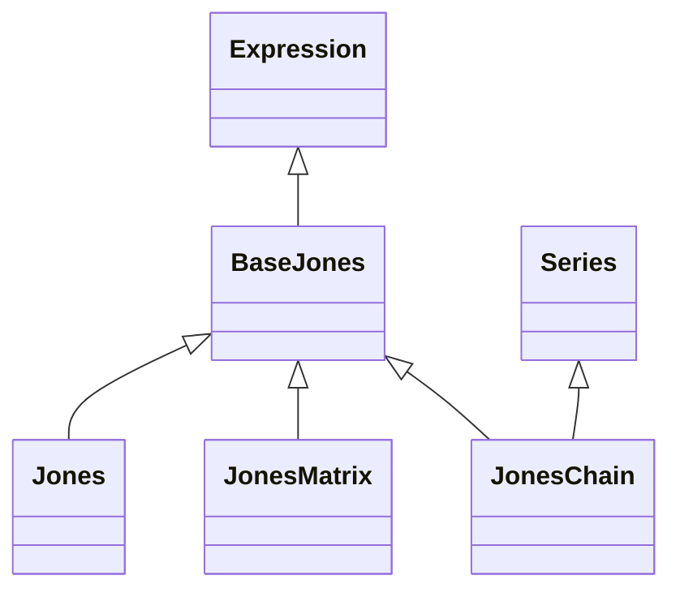

<!-- Generated by docs/scripts/generate_api_mds.py; do not edit. -->

# Optical / Jones

## Inheritance

???+ info "BaseJones"
    ::: dLux.utils.optical.jones.BaseJones
        options:
          merge_init_into_class: true
          inherited_members: [__init__]

???+ info "Jones"
    ::: dLux.utils.optical.jones.Jones
        options:
          merge_init_into_class: true
          inherited_members: [__init__]

???+ info "JonesMatrix"
    ::: dLux.utils.optical.jones.JonesMatrix
        options:
          merge_init_into_class: true
          inherited_members: [__init__]

???+ info "JonesChain"
    ::: dLux.utils.optical.jones.JonesChain
        options:
          merge_init_into_class: true
          inherited_members: [__init__]
