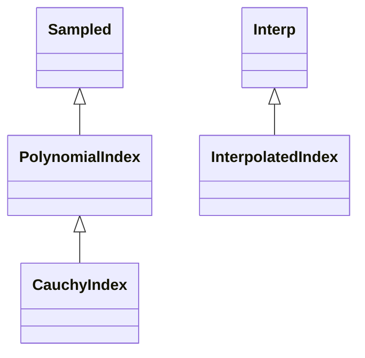

<!-- Generated by docs/scripts/generate_api_mds.py; do not edit. -->

# Optical / Refractive

## Inheritance

???+ info "CauchyIndex"
    ::: dLux.utils.optical.refractive.CauchyIndex
        options:
          merge_init_into_class: true
          inherited_members: [__init__]

???+ info "PolynomialIndex"
    ::: dLux.utils.optical.refractive.PolynomialIndex
        options:
          merge_init_into_class: true
          inherited_members: [__init__]

???+ info "InterpolatedIndex"
    ::: dLux.utils.optical.refractive.InterpolatedIndex
        options:
          merge_init_into_class: true
          inherited_members: [__init__]
