<!-- Generated by docs/scripts/generate_api_mds.py; do not edit. -->

# Utils

See the [usage overview](../../overviews/utils/overview.md) for examples.

These maps are generated from the public API. Each module is shown separately so its complete local structure remains readable. Select a class to open its reference, or follow the module heading for functions and full documentation.

## [Astrometry](astrometry.md)

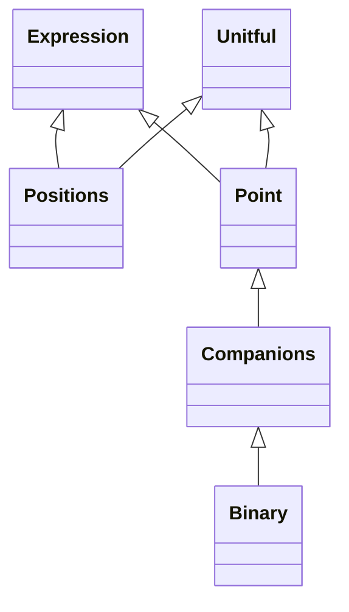


## [Bases](bases.md)

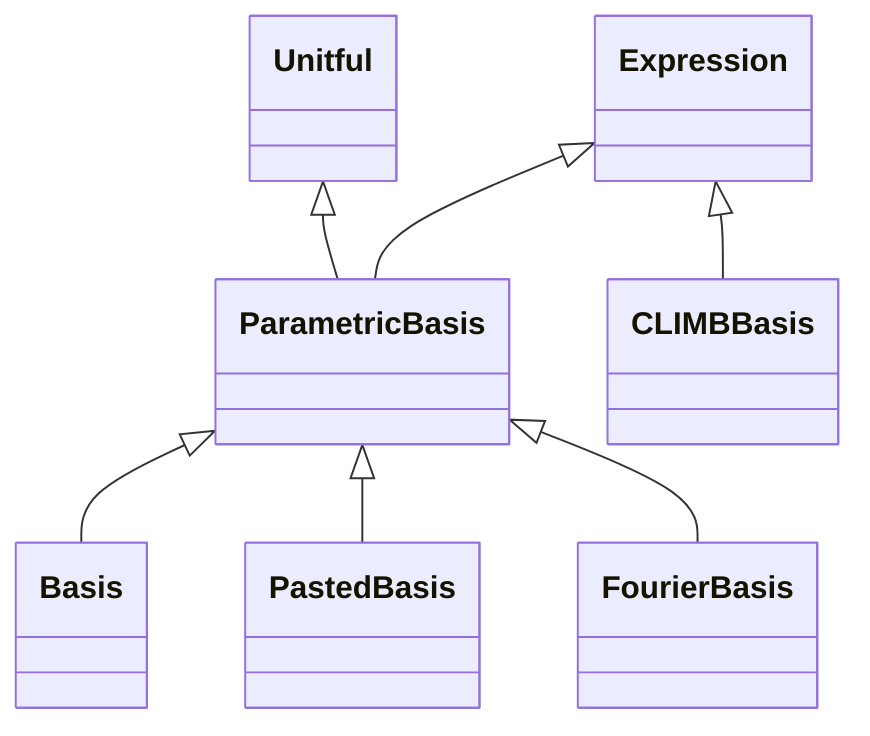

Functions: [`initialise_coeffs`](bases.md#dLux.utils.bases.basis.initialise_coeffs), [`eval_basis`](bases.md#dLux.utils.bases.basis.eval_basis), [`solve_basis`](bases.md#dLux.utils.bases.basis.solve_basis), [`fourier_kernel_1d`](bases.md#dLux.utils.bases.fourier.fourier_kernel_1d), [`fourier_kernels`](bases.md#dLux.utils.bases.fourier.fourier_kernels), [`soft_binarise`](bases.md#dLux.utils.bases.climb.soft_binarise).


## [Bases / Basis](bases/basis.md)

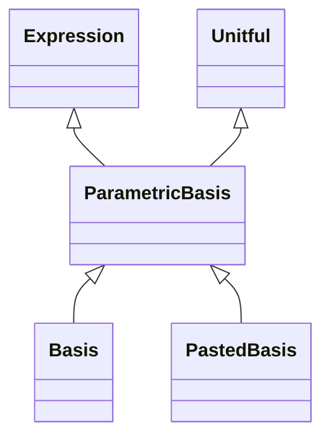

Functions: [`initialise_coeffs`](bases/basis.md#dLux.utils.bases.basis.initialise_coeffs), [`eval_basis`](bases/basis.md#dLux.utils.bases.basis.eval_basis), [`solve_basis`](bases/basis.md#dLux.utils.bases.basis.solve_basis).


## [Bases / CLIMB](bases/climb.md)

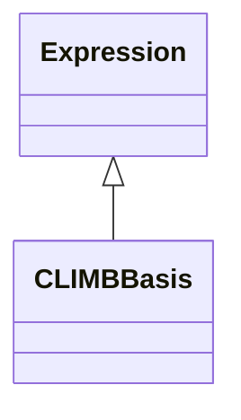

Functions: [`soft_binarise`](bases/climb.md#dLux.utils.bases.climb.soft_binarise).


## [Bases / Fourier](bases/fourier.md)

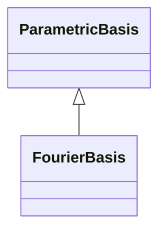

Functions: [`fourier_kernel_1d`](bases/fourier.md#dLux.utils.bases.fourier.fourier_kernel_1d), [`fourier_kernels`](bases/fourier.md#dLux.utils.bases.fourier.fourier_kernels).


## [Batching](batching.md)

Functions: [`as_axis`](batching.md#dLux.utils.batching.as_axis), [`broadcast_batch`](batching.md#dLux.utils.batching.broadcast_batch), [`broadcast_batches`](batching.md#dLux.utils.batching.broadcast_batches), [`flatten_batch`](batching.md#dLux.utils.batching.flatten_batch).


## [Compat](compat.md)

Deprecated aliases and migration errors are documented on the compatibility API page. They are omitted from the conceptual class maps because they mirror earlier APIs rather than define the current package structure.


## [Compat / Apertures](compat/apertures.md)

Deprecated aliases and migration errors are documented on the compatibility API page. They are omitted from the conceptual class maps because they mirror earlier APIs rather than define the current package structure.


## [Compat / Array Ops](compat/array_ops.md)

Deprecated aliases and migration errors are documented on the compatibility API page. They are omitted from the conceptual class maps because they mirror earlier APIs rather than define the current package structure.


## [Compat / Coordinates](compat/coordinates.md)

Deprecated aliases and migration errors are documented on the compatibility API page. They are omitted from the conceptual class maps because they mirror earlier APIs rather than define the current package structure.


## [Compat / Fourier](compat/fourier.md)

Deprecated aliases and migration errors are documented on the compatibility API page. They are omitted from the conceptual class maps because they mirror earlier APIs rather than define the current package structure.


## [Compat / Geometry](compat/geometry.md)

Deprecated aliases and migration errors are documented on the compatibility API page. They are omitted from the conceptual class maps because they mirror earlier APIs rather than define the current package structure.


## [Compat / Helpers](compat/helpers.md)

Deprecated aliases and migration errors are documented on the compatibility API page. They are omitted from the conceptual class maps because they mirror earlier APIs rather than define the current package structure.


## [Compat / Interpolation](compat/interpolation.md)

Deprecated aliases and migration errors are documented on the compatibility API page. They are omitted from the conceptual class maps because they mirror earlier APIs rather than define the current package structure.


## [Compat / Math](compat/math.md)

Deprecated aliases and migration errors are documented on the compatibility API page. They are omitted from the conceptual class maps because they mirror earlier APIs rather than define the current package structure.


## [Compat / Misc](compat/misc.md)

Deprecated aliases and migration errors are documented on the compatibility API page. They are omitted from the conceptual class maps because they mirror earlier APIs rather than define the current package structure.


## [Compat / Norms](compat/norms.md)

Deprecated aliases and migration errors are documented on the compatibility API page. They are omitted from the conceptual class maps because they mirror earlier APIs rather than define the current package structure.


## [Compat / Optics](compat/optics.md)

Deprecated aliases and migration errors are documented on the compatibility API page. They are omitted from the conceptual class maps because they mirror earlier APIs rather than define the current package structure.


## [Compat / Polarisation](compat/polarisation.md)

Deprecated aliases and migration errors are documented on the compatibility API page. They are omitted from the conceptual class maps because they mirror earlier APIs rather than define the current package structure.


## [Compat / Polynomials](compat/polynomials.md)

Deprecated aliases and migration errors are documented on the compatibility API page. They are omitted from the conceptual class maps because they mirror earlier APIs rather than define the current package structure.


## [Compat / Propagation](compat/propagation.md)

Deprecated aliases and migration errors are documented on the compatibility API page. They are omitted from the conceptual class maps because they mirror earlier APIs rather than define the current package structure.


## [Compat / Registration](compat/registration.md)

Deprecated aliases and migration errors are documented on the compatibility API page. They are omitted from the conceptual class maps because they mirror earlier APIs rather than define the current package structure.


## [Compat / Source](compat/source.md)

Deprecated aliases and migration errors are documented on the compatibility API page. They are omitted from the conceptual class maps because they mirror earlier APIs rather than define the current package structure.


## [Compat / Units](compat/units.md)

Deprecated aliases and migration errors are documented on the compatibility API page. They are omitted from the conceptual class maps because they mirror earlier APIs rather than define the current package structure.


## [Compat / Zernikes](compat/zernikes.md)

Deprecated aliases and migration errors are documented on the compatibility API page. They are omitted from the conceptual class maps because they mirror earlier APIs rather than define the current package structure.


## [Grids](grids.md)

```mermaid
classDiagram
    direction TB
    class dLux_utils_grids_specs_Spec["Spec"]
    class dLux_utils_grids_specs_UnitSpec["UnitSpec"]
    class dLux_utils_grids_specs_Axis["Axis"]
    class dLux_utils_grids_array_ops_ResizeSpec["ResizeSpec"]
    class dLux_utils_grids_array_ops_FFTSpec["FFTSpec"]
    class dLux_utils_grids_transforms_BaseCoordTransform["BaseCoordTransform"]
    class dLux_utils_grids_transforms_Affine["Affine"]
    class dLux_utils_grids_transforms_AffineMap["AffineMap"]
    class dLux_utils_grids_transforms_TransformChain["TransformChain"]
    class dLux_utils_grids_transforms_Distortion["Distortion"]
    class dLux_utils_grids_transforms_Transform["Transform"]
    class dLux_utils_grids_grid_Grid["Grid"]
    class dLux_utils_grids_paste_PasteSpec["PasteSpec"]
    class dLux_utils_grids_fields_Field["Field"]
    class dLux_utils_numerical_units_Unitful["Unitful"]
    class dLux_utils_sequential_Series["Series"]
    class zodiax_module_Module["Module"]
    zodiax_module_Module <|-- dLux_utils_grids_specs_Spec
    click dLux_utils_grids_specs_Spec href "../grids/#dLux.utils.grids.specs.Spec" "Attributes: n, ndim · Properties: shape · Methods: __init__()"
    dLux_utils_grids_specs_Spec <|-- dLux_utils_grids_specs_UnitSpec
    dLux_utils_numerical_units_Unitful <|-- dLux_utils_grids_specs_UnitSpec
    click dLux_utils_grids_specs_UnitSpec href "../grids/#dLux.utils.grids.specs.UnitSpec" "Attributes: unit, d, c · Properties: ndim, batch_shape, d_si, c_si, axes, coordinates, cell_volume, fov · Methods: __init__(), match_shape(), resample(), resize(), resize_samples(), downsample(), oversample()"
    dLux_utils_grids_specs_UnitSpec <|-- dLux_utils_grids_specs_Axis
    click dLux_utils_grids_specs_Axis href "../grids/#dLux.utils.grids.specs.Axis" "Attributes: unit, n, d, c · Properties: ndim, values, integration_weights · Methods: __init__()"
    dLux_utils_grids_specs_Spec <|-- dLux_utils_grids_array_ops_ResizeSpec
    click dLux_utils_grids_array_ops_ResizeSpec href "../grids/#dLux.utils.grids.array_ops.ResizeSpec" "Attributes: n, pad, crop · Properties: ndim, explicit · Methods: __init__(), counts(), output_size(), crop_size(), pad_array(), crop_array(), crop_axes(), resize()"
    dLux_utils_grids_array_ops_ResizeSpec <|-- dLux_utils_grids_array_ops_FFTSpec
    click dLux_utils_grids_array_ops_FFTSpec href "../grids/#dLux.utils.grids.array_ops.FFTSpec" "Attributes: n, pad, crop, c · Methods: __init__(), working_grid(), output_grid()"
    zodiax_module_Module <|-- dLux_utils_grids_transforms_BaseCoordTransform
    click dLux_utils_grids_transforms_BaseCoordTransform href "../grids/#dLux.utils.grids.transforms.BaseCoordTransform" "Methods: get_coordinates(), __call__(), apply(), __init__()"
    dLux_utils_grids_transforms_BaseCoordTransform <|-- dLux_utils_grids_transforms_Affine
    click dLux_utils_grids_transforms_Affine href "../grids/#dLux.utils.grids.transforms.Affine" "Attributes: translation, rotation, scale, shear, order · Properties: coeffs · Methods: __init__(), __call__()"
    dLux_utils_grids_transforms_BaseCoordTransform <|-- dLux_utils_grids_transforms_AffineMap
    click dLux_utils_grids_transforms_AffineMap href "../grids/#dLux.utils.grids.transforms.AffineMap" "Attributes: matrix, offset · Methods: __init__(), __call__()"
    dLux_utils_sequential_Series <|-- dLux_utils_grids_transforms_TransformChain
    dLux_utils_grids_transforms_BaseCoordTransform <|-- dLux_utils_grids_transforms_TransformChain
    click dLux_utils_grids_transforms_TransformChain href "../grids/#dLux.utils.grids.transforms.TransformChain" "Attributes: layers, grid · Methods: __init__(), evaluate(), apply()"
    dLux_utils_grids_transforms_BaseCoordTransform <|-- dLux_utils_grids_transforms_Distortion
    click dLux_utils_grids_transforms_Distortion href "../grids/#dLux.utils.grids.transforms.Distortion" "Attributes: powers, distortion · Methods: __init__(), __call__()"
    dLux_utils_grids_transforms_BaseCoordTransform <|-- dLux_utils_grids_transforms_Transform
    click dLux_utils_grids_transforms_Transform href "../grids/#dLux.utils.grids.transforms.Transform" "Attributes: affine, polynomial · Methods: __init__(), __call__()"
    dLux_utils_grids_specs_UnitSpec <|-- dLux_utils_grids_grid_Grid
    click dLux_utils_grids_grid_Grid href "../grids/#dLux.utils.grids.grid.Grid" "Attributes: unit, n, d, c · Properties: ndim · Methods: __init__(), check_sampling(), frequency(), from_axes(), transformed(), extent()"
    dLux_utils_grids_specs_Spec <|-- dLux_utils_grids_paste_PasteSpec
    click dLux_utils_grids_paste_PasteSpec href "../grids/#dLux.utils.grids.paste.PasteSpec" "Attributes: n, stamp_shape, starts, offsets, d · Properties: ndim, coordinates · Methods: __init__(), from_grid(), paste(), extract()"
    zodiax_module_Module <|-- dLux_utils_grids_fields_Field
    click dLux_utils_grids_fields_Field href "../grids/#dLux.utils.grids.fields.Field" "Attributes: array, grid · Properties: real, imaginary, imag, amplitude, phase, intensity, complex, polar, field, batch_ndim, spatial_shape, axes, coordinates, xs, npixels, pixel_scale, center, diameter · Methods: __init__(), convolve(), resize(), downsample(), flip(), sample(), resample(), scale_to(), interpolate(), rotate()"
```


## [Grids / Array Ops](grids/array_ops.md)

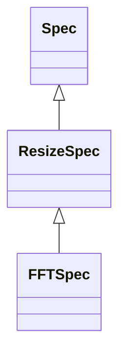

Functions: [`as_size`](grids/array_ops.md#dLux.utils.grids.array_ops.as_size), [`pad_to`](grids/array_ops.md#dLux.utils.grids.array_ops.pad_to), [`crop_to`](grids/array_ops.md#dLux.utils.grids.array_ops.crop_to), [`resize`](grids/array_ops.md#dLux.utils.grids.array_ops.resize), [`downsample`](grids/array_ops.md#dLux.utils.grids.array_ops.downsample).


## [Grids / Coordinates](grids/coordinates.md)

Functions: [`coordinate_grid`](grids/coordinates.md#dLux.utils.grids.coordinates.coordinate_grid), [`cart2polar`](grids/coordinates.md#dLux.utils.grids.coordinates.cart2polar), [`polar2cart`](grids/coordinates.md#dLux.utils.grids.coordinates.polar2cart).


## [Grids / Fields](grids/fields.md)

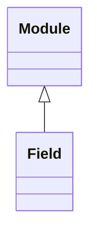


## [Grids / Grid](grids/grid.md)

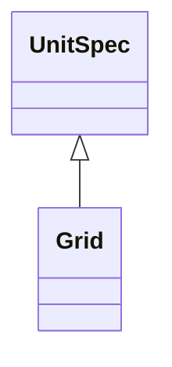


## [Grids / Paste](grids/paste.md)

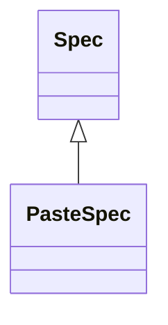

Functions: [`paste`](grids/paste.md#dLux.utils.grids.paste.paste).


## [Grids / Specs](grids/specs.md)

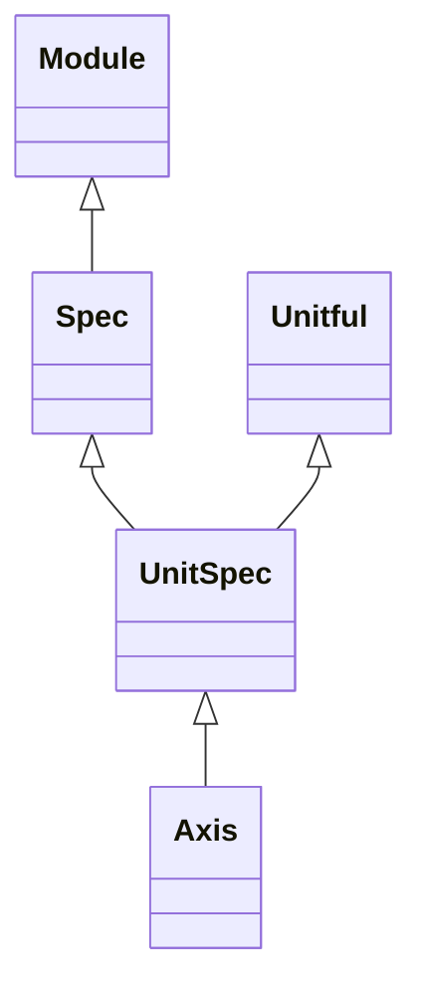


## [Grids / Transforms](grids/transforms.md)

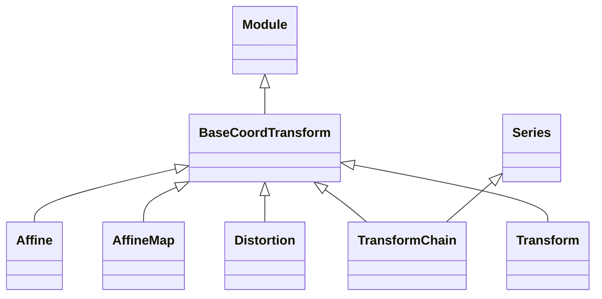


## [Numerical](numerical.md)

```mermaid
classDiagram
    direction TB
    class dLux_utils_numerical_units_Unitful["Unitful"]
    class dLux_utils_numerical_norms_Norm["Norm"]
    class dLux_utils_numerical_interpolation_Interp["Interp"]
    class dLux_utils_numerical_polynomials_Polynomial["Polynomial"]
    class dLux_utils_numerical_gaussians_Gaussian["Gaussian"]
    class dLux_utils_numerical_gaussians_CorrelatedGaussian["CorrelatedGaussian"]
    class dLux_utils_numerical_gaussians_EllipticalGaussian["EllipticalGaussian"]
    class dLux_utils_numerical_shapes_Shape["Shape"]
    class dLux_utils_numerical_shapes_InvertibleShape["InvertibleShape"]
    class dLux_utils_numerical_shapes_Soft["Soft"]
    class dLux_utils_numerical_shapes_Circle["Circle"]
    class dLux_utils_numerical_shapes_Square["Square"]
    class dLux_utils_numerical_shapes_Rectangle["Rectangle"]
    class dLux_utils_numerical_shapes_RegularPolygon["RegularPolygon"]
    class dLux_utils_numerical_shapes_ConvexPolygon["ConvexPolygon"]
    class dLux_utils_numerical_shapes_Spider["Spider"]
    class dLux_utils_numerical_shapes_Complement["Complement"]
    class dLux_utils_numerical_profiles_Profile["Profile"]
    class dLux_utils_numerical_profiles_Jitter["Jitter"]
    class dLux_utils_bases_basis_ParametricBasis["ParametricBasis"]
    class dLux_utils_sampled_Sampled["Sampled"]
    class zodiax_module_Module["Module"]
    class zodiax_numerics_expressions_Expression["Expression"]
    zodiax_module_Module <|-- dLux_utils_numerical_units_Unitful
    click dLux_utils_numerical_units_Unitful href "../numerical/#dLux.utils.numerical.units.Unitful" "Attributes: unit · Methods: validate_unit(), __init__()"
    zodiax_numerics_expressions_Expression <|-- dLux_utils_numerical_norms_Norm
    click dLux_utils_numerical_norms_Norm href "../numerical/#dLux.utils.numerical.norms.Norm" "Attributes: x, weights, mode, axis, keepdims · Methods: __init__(), evaluate()"
    zodiax_numerics_expressions_Expression <|-- dLux_utils_numerical_interpolation_Interp
    click dLux_utils_numerical_interpolation_Interp href "../numerical/#dLux.utils.numerical.interpolation.Interp" "Attributes: array, grid_in, grid_out, transform, ndim, method, complex, fill, interpolator · Properties: axes · Methods: __init__(), evaluate(), __call__(), apply(), output_grid(), prepare(), sample()"
    dLux_utils_sampled_Sampled <|-- dLux_utils_numerical_polynomials_Polynomial
    dLux_utils_bases_basis_ParametricBasis <|-- dLux_utils_numerical_polynomials_Polynomial
    click dLux_utils_numerical_polynomials_Polynomial href "../numerical/#dLux.utils.numerical.polynomials.Polynomial" "Attributes: unit, grid, transform, strict, coeffs, powers · Properties: coeffs_ndim · Methods: __init__(), sampling_context(), calculate_basis(), evaluate(), solve()"
    dLux_utils_sampled_Sampled <|-- dLux_utils_numerical_gaussians_Gaussian
    click dLux_utils_numerical_gaussians_Gaussian href "../numerical/#dLux.utils.numerical.gaussians.Gaussian" "Attributes: grid, transform, strict, std, mean · Methods: __init__(), evaluate(), log_profile()"
    dLux_utils_sampled_Sampled <|-- dLux_utils_numerical_gaussians_CorrelatedGaussian
    click dLux_utils_numerical_gaussians_CorrelatedGaussian href "../numerical/#dLux.utils.numerical.gaussians.CorrelatedGaussian" "Attributes: grid, transform, strict, stds, corr, mean · Properties: cov · Methods: __init__(), evaluate(), log_profile(), from_cov()"
    dLux_utils_sampled_Sampled <|-- dLux_utils_numerical_gaussians_EllipticalGaussian
    click dLux_utils_numerical_gaussians_EllipticalGaussian href "../numerical/#dLux.utils.numerical.gaussians.EllipticalGaussian" "Attributes: grid, transform, strict, major, ratio, angle, mean · Properties: minor, cov · Methods: __init__(), evaluate(), log_profile()"
    dLux_utils_sampled_Sampled <|-- dLux_utils_numerical_shapes_Shape
    click dLux_utils_numerical_shapes_Shape href "../numerical/#dLux.utils.numerical.shapes.Shape" "Attributes: grid, transform, strict · Properties: extent"
    dLux_utils_numerical_shapes_Shape <|-- dLux_utils_numerical_shapes_InvertibleShape
    click dLux_utils_numerical_shapes_InvertibleShape href "../numerical/#dLux.utils.numerical.shapes.InvertibleShape" "Attributes: grid, transform, strict, edge, invert · Methods: __init__(), evaluate(), distance(), evaluate_hard(), evaluate_soft()"
    zodiax_module_Module <|-- dLux_utils_numerical_shapes_Soft
    click dLux_utils_numerical_shapes_Soft href "../numerical/#dLux.utils.numerical.shapes.Soft" "Attributes: pixels · Methods: __init__(), clip()"
    dLux_utils_numerical_shapes_InvertibleShape <|-- dLux_utils_numerical_shapes_Circle
    click dLux_utils_numerical_shapes_Circle href "../numerical/#dLux.utils.numerical.shapes.Circle" "Attributes: grid, transform, strict, edge, invert, diameter · Properties: extent · Methods: __init__(), distance()"
    dLux_utils_numerical_shapes_InvertibleShape <|-- dLux_utils_numerical_shapes_Square
    click dLux_utils_numerical_shapes_Square href "../numerical/#dLux.utils.numerical.shapes.Square" "Attributes: grid, transform, strict, edge, invert, width · Properties: extent · Methods: __init__(), distance()"
    dLux_utils_numerical_shapes_InvertibleShape <|-- dLux_utils_numerical_shapes_Rectangle
    click dLux_utils_numerical_shapes_Rectangle href "../numerical/#dLux.utils.numerical.shapes.Rectangle" "Attributes: grid, transform, strict, edge, invert, width, height · Properties: extent · Methods: __init__(), distance()"
    dLux_utils_numerical_shapes_InvertibleShape <|-- dLux_utils_numerical_shapes_RegularPolygon
    click dLux_utils_numerical_shapes_RegularPolygon href "../numerical/#dLux.utils.numerical.shapes.RegularPolygon" "Attributes: grid, transform, strict, edge, invert, diameter, nsides · Properties: extent · Methods: __init__(), distance()"
    dLux_utils_numerical_shapes_InvertibleShape <|-- dLux_utils_numerical_shapes_ConvexPolygon
    click dLux_utils_numerical_shapes_ConvexPolygon href "../numerical/#dLux.utils.numerical.shapes.ConvexPolygon" "Attributes: grid, transform, strict, edge, invert, vertices · Properties: extent · Methods: __init__(), distance(), evaluate_hard(), validate()"
    dLux_utils_numerical_shapes_InvertibleShape <|-- dLux_utils_numerical_shapes_Spider
    click dLux_utils_numerical_shapes_Spider href "../numerical/#dLux.utils.numerical.shapes.Spider" "Attributes: grid, transform, strict, edge, invert, width, angles · Methods: __init__(), distance()"
    dLux_utils_numerical_shapes_Shape <|-- dLux_utils_numerical_shapes_Complement
    click dLux_utils_numerical_shapes_Complement href "../numerical/#dLux.utils.numerical.shapes.Complement" "Attributes: grid, transform, strict, shape · Properties: extent · Methods: __init__(), evaluate()"
    zodiax_module_Module <|-- dLux_utils_numerical_profiles_Profile
    click dLux_utils_numerical_profiles_Profile href "../numerical/#dLux.utils.numerical.profiles.Profile" "Attributes: profile, grid, oversample, normalise · Methods: __init__(), sample()"
    zodiax_numerics_expressions_Expression <|-- dLux_utils_numerical_profiles_Jitter
    dLux_utils_numerical_units_Unitful <|-- dLux_utils_numerical_profiles_Jitter
    click dLux_utils_numerical_profiles_Jitter href "../numerical/#dLux.utils.numerical.profiles.Jitter" "Attributes: profile, unit, kernel_size, oversample · Methods: __init__(), evaluate()"
```

Functions: [`triangular_number`](numerical.md#dLux.utils.numerical.math.triangular_number), [`nandiv`](numerical.md#dLux.utils.numerical.math.nandiv), [`from_complex`](numerical.md#dLux.utils.numerical.math.from_complex), [`to_complex`](numerical.md#dLux.utils.numerical.math.to_complex), [`canonical_unit`](numerical.md#dLux.utils.numerical.units.canonical_unit), [`unit_dimension`](numerical.md#dLux.utils.numerical.units.unit_dimension), [`unit_factor`](numerical.md#dLux.utils.numerical.units.unit_factor), [`unit_factor_to_rad`](numerical.md#dLux.utils.numerical.units.unit_factor_to_rad), [`convert`](numerical.md#dLux.utils.numerical.units.convert), [`norm`](numerical.md#dLux.utils.numerical.norms.norm), [`normalise`](numerical.md#dLux.utils.numerical.norms.normalise), [`interp`](numerical.md#dLux.utils.numerical.interpolation.interp), [`polynomial_powers`](numerical.md#dLux.utils.numerical.polynomials.polynomial_powers), [`polynomial_basis`](numerical.md#dLux.utils.numerical.polynomials.polynomial_basis), [`eval_polynomial`](numerical.md#dLux.utils.numerical.polynomials.eval_polynomial), [`solve_polynomial`](numerical.md#dLux.utils.numerical.polynomials.solve_polynomial), [`eval_gaussian`](numerical.md#dLux.utils.numerical.gaussians.eval_gaussian), [`eval_mv_gaussian`](numerical.md#dLux.utils.numerical.gaussians.eval_mv_gaussian), [`log_gaussian`](numerical.md#dLux.utils.numerical.gaussians.log_gaussian), [`log_mv_gaussian`](numerical.md#dLux.utils.numerical.gaussians.log_mv_gaussian), [`correlated_covariance`](numerical.md#dLux.utils.numerical.gaussians.correlated_covariance), [`elliptical_covariance`](numerical.md#dLux.utils.numerical.gaussians.elliptical_covariance), [`shift_and_scale`](numerical.md#dLux.utils.numerical.shapes.shift_and_scale), [`soften`](numerical.md#dLux.utils.numerical.shapes.soften), [`circ_distance`](numerical.md#dLux.utils.numerical.shapes.circ_distance), [`square_distance`](numerical.md#dLux.utils.numerical.shapes.square_distance), [`rectangle_distance`](numerical.md#dLux.utils.numerical.shapes.rectangle_distance), [`spider_distance`](numerical.md#dLux.utils.numerical.shapes.spider_distance), [`line_distance`](numerical.md#dLux.utils.numerical.shapes.line_distance), [`reg_polygon_edges`](numerical.md#dLux.utils.numerical.shapes.reg_polygon_edges), [`reg_polygon_distance`](numerical.md#dLux.utils.numerical.shapes.reg_polygon_distance), [`convex_polygon_distance`](numerical.md#dLux.utils.numerical.shapes.convex_polygon_distance), [`validate_convex`](numerical.md#dLux.utils.numerical.shapes.validate_convex).


## [Numerical / Gaussians](numerical/gaussians.md)

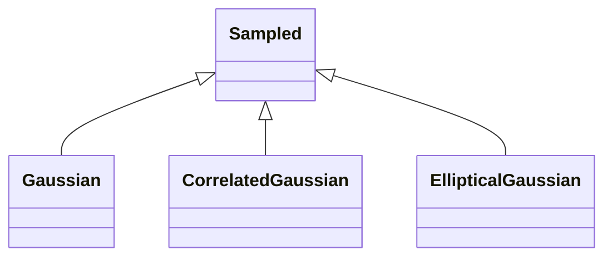

Functions: [`eval_gaussian`](numerical/gaussians.md#dLux.utils.numerical.gaussians.eval_gaussian), [`eval_mv_gaussian`](numerical/gaussians.md#dLux.utils.numerical.gaussians.eval_mv_gaussian), [`log_gaussian`](numerical/gaussians.md#dLux.utils.numerical.gaussians.log_gaussian), [`log_mv_gaussian`](numerical/gaussians.md#dLux.utils.numerical.gaussians.log_mv_gaussian), [`correlated_covariance`](numerical/gaussians.md#dLux.utils.numerical.gaussians.correlated_covariance), [`elliptical_covariance`](numerical/gaussians.md#dLux.utils.numerical.gaussians.elliptical_covariance).


## [Numerical / Interpolation](numerical/interpolation.md)


Functions: [`interp`](numerical/interpolation.md#dLux.utils.numerical.interpolation.interp).


## [Numerical / Math](numerical/math.md)

Functions: [`triangular_number`](numerical/math.md#dLux.utils.numerical.math.triangular_number), [`nandiv`](numerical/math.md#dLux.utils.numerical.math.nandiv), [`from_complex`](numerical/math.md#dLux.utils.numerical.math.from_complex), [`to_complex`](numerical/math.md#dLux.utils.numerical.math.to_complex).


## [Numerical / Norms](numerical/norms.md)

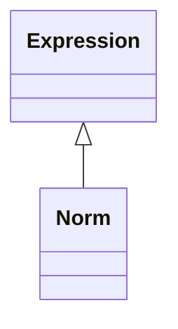

Functions: [`norm`](numerical/norms.md#dLux.utils.numerical.norms.norm), [`normalise`](numerical/norms.md#dLux.utils.numerical.norms.normalise).


## [Numerical / Polynomials](numerical/polynomials.md)

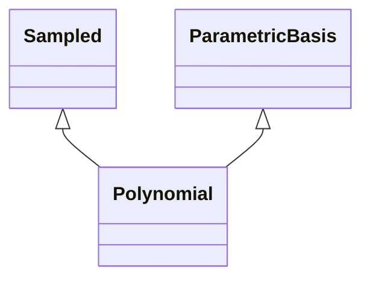

Functions: [`polynomial_powers`](numerical/polynomials.md#dLux.utils.numerical.polynomials.polynomial_powers), [`polynomial_basis`](numerical/polynomials.md#dLux.utils.numerical.polynomials.polynomial_basis), [`eval_polynomial`](numerical/polynomials.md#dLux.utils.numerical.polynomials.eval_polynomial), [`solve_polynomial`](numerical/polynomials.md#dLux.utils.numerical.polynomials.solve_polynomial).


## [Numerical / Profiles](numerical/profiles.md)

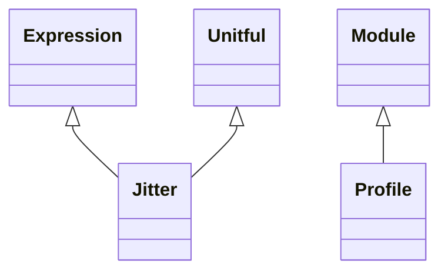


## [Numerical / Shapes](numerical/shapes.md)

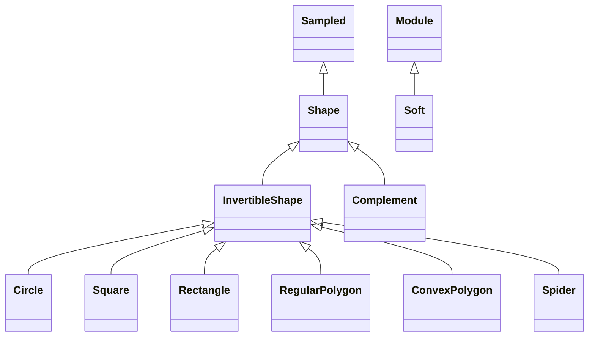

Functions: [`shift_and_scale`](numerical/shapes.md#dLux.utils.numerical.shapes.shift_and_scale), [`soften`](numerical/shapes.md#dLux.utils.numerical.shapes.soften), [`circ_distance`](numerical/shapes.md#dLux.utils.numerical.shapes.circ_distance), [`square_distance`](numerical/shapes.md#dLux.utils.numerical.shapes.square_distance), [`rectangle_distance`](numerical/shapes.md#dLux.utils.numerical.shapes.rectangle_distance), [`spider_distance`](numerical/shapes.md#dLux.utils.numerical.shapes.spider_distance), [`line_distance`](numerical/shapes.md#dLux.utils.numerical.shapes.line_distance), [`reg_polygon_edges`](numerical/shapes.md#dLux.utils.numerical.shapes.reg_polygon_edges), [`reg_polygon_distance`](numerical/shapes.md#dLux.utils.numerical.shapes.reg_polygon_distance), [`convex_polygon_distance`](numerical/shapes.md#dLux.utils.numerical.shapes.convex_polygon_distance), [`validate_convex`](numerical/shapes.md#dLux.utils.numerical.shapes.validate_convex).


## [Numerical / Units](numerical/units.md)

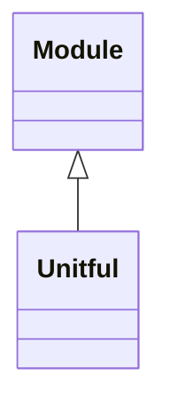

Functions: [`canonical_unit`](numerical/units.md#dLux.utils.numerical.units.canonical_unit), [`unit_dimension`](numerical/units.md#dLux.utils.numerical.units.unit_dimension), [`unit_factor`](numerical/units.md#dLux.utils.numerical.units.unit_factor), [`unit_factor_to_rad`](numerical/units.md#dLux.utils.numerical.units.unit_factor_to_rad), [`convert`](numerical/units.md#dLux.utils.numerical.units.convert).


## [Optical](optical.md)

```mermaid
classDiagram
    direction TB
    class dLux_utils_optical_jones_BaseJones["BaseJones"]
    class dLux_utils_optical_jones_Jones["Jones"]
    class dLux_utils_optical_jones_JonesMatrix["JonesMatrix"]
    class dLux_utils_optical_jones_JonesChain["JonesChain"]
    class dLux_utils_optical_refractive_CauchyIndex["CauchyIndex"]
    class dLux_utils_optical_refractive_PolynomialIndex["PolynomialIndex"]
    class dLux_utils_optical_refractive_InterpolatedIndex["InterpolatedIndex"]
    class dLux_utils_optical_zernikes_Zernike["Zernike"]
    class dLux_utils_numerical_interpolation_Interp["Interp"]
    class dLux_utils_sampled_Sampled["Sampled"]
    class dLux_utils_sequential_Series["Series"]
    class zodiax_numerics_expressions_Expression["Expression"]
    zodiax_numerics_expressions_Expression <|-- dLux_utils_optical_jones_BaseJones
    click dLux_utils_optical_jones_BaseJones href "../optical/#dLux.utils.optical.jones.BaseJones" "Methods: evaluate(), from_matrix(), apply(), __call__(), rotate(), then(), mueller(), to_stokes(), __init__()"
    dLux_utils_optical_jones_BaseJones <|-- dLux_utils_optical_jones_Jones
    click dLux_utils_optical_jones_Jones href "../optical/#dLux.utils.optical.jones.Jones" "Attributes: angle, retardance · Methods: __init__(), evaluate(), rotate(), LinearPolariser(), HorizontalPolariser(), VerticalPolariser(), Retarder(), HalfWavePlate(), QuarterWavePlate(), Identity(), RHCPolariser(), LHCPolariser(), linear_polariser(), horizontal_polariser(), vertical_polariser(), retarder(), half_wave_plate(), quarter_wave_plate(), identity(), rhc_polariser(), lhc_polariser(), rotate_matrix()"
    dLux_utils_optical_jones_BaseJones <|-- dLux_utils_optical_jones_JonesMatrix
    click dLux_utils_optical_jones_JonesMatrix href "../optical/#dLux.utils.optical.jones.JonesMatrix" "Attributes: matrix · Methods: __init__(), evaluate()"
    dLux_utils_sequential_Series <|-- dLux_utils_optical_jones_JonesChain
    dLux_utils_optical_jones_BaseJones <|-- dLux_utils_optical_jones_JonesChain
    click dLux_utils_optical_jones_JonesChain href "../optical/#dLux.utils.optical.jones.JonesChain" "Attributes: layers · Methods: __init__(), evaluate(), apply(), debug()"
    dLux_utils_optical_refractive_PolynomialIndex <|-- dLux_utils_optical_refractive_CauchyIndex
    click dLux_utils_optical_refractive_CauchyIndex href "../optical/#dLux.utils.optical.refractive.CauchyIndex" "Attributes: grid, transform, strict, coeffs, powers, scale"
    dLux_utils_sampled_Sampled <|-- dLux_utils_optical_refractive_PolynomialIndex
    click dLux_utils_optical_refractive_PolynomialIndex href "../optical/#dLux.utils.optical.refractive.PolynomialIndex" "Attributes: grid, transform, strict, coeffs, powers, scale · Methods: __init__(), evaluate()"
    dLux_utils_numerical_interpolation_Interp <|-- dLux_utils_optical_refractive_InterpolatedIndex
    click dLux_utils_optical_refractive_InterpolatedIndex href "../optical/#dLux.utils.optical.refractive.InterpolatedIndex" "Attributes: array, grid_in, grid_out, transform, complex, interpolator, ndim, method, fill · Methods: __init__(), evaluate()"
    dLux_utils_sampled_Sampled <|-- dLux_utils_optical_zernikes_Zernike
    click dLux_utils_optical_zernikes_Zernike href "../optical/#dLux.utils.optical.zernikes.Zernike" "Attributes: grid, transform, strict, names, nolls, groups, order, diameter, n_sides, oversize, norm, method, support, centers · Properties: coeffs_shape · Methods: __init__(), evaluate(), name(), noll_indices(), radial_orders_to_indices(), indices(), factors(), radial(), azimuthal(), mode()"
```

Functions: [`wavenumber`](optical.md#dLux.utils.optical.phase.wavenumber), [`opd2phase`](optical.md#dLux.utils.optical.phase.opd2phase), [`phase2opd`](optical.md#dLux.utils.optical.phase.phase2opd), [`fringe_size`](optical.md#dLux.utils.optical.phase.fringe_size), [`tilt_opd`](optical.md#dLux.utils.optical.phase.tilt_opd), [`tilt`](optical.md#dLux.utils.optical.phase.tilt).


## [Optical / Jones](optical/jones.md)

```mermaid
classDiagram
    direction TB
    class dLux_utils_optical_jones_BaseJones["BaseJones"]
    class dLux_utils_optical_jones_Jones["Jones"]
    class dLux_utils_optical_jones_JonesMatrix["JonesMatrix"]
    class dLux_utils_optical_jones_JonesChain["JonesChain"]
    class dLux_utils_sequential_Series["Series"]
    class zodiax_numerics_expressions_Expression["Expression"]
    zodiax_numerics_expressions_Expression <|-- dLux_utils_optical_jones_BaseJones
    click dLux_utils_optical_jones_BaseJones href "../optical/jones/#dLux.utils.optical.jones.BaseJones" "Methods: evaluate(), from_matrix(), apply(), __call__(), rotate(), then(), mueller(), to_stokes(), __init__()"
    dLux_utils_optical_jones_BaseJones <|-- dLux_utils_optical_jones_Jones
    click dLux_utils_optical_jones_Jones href "../optical/jones/#dLux.utils.optical.jones.Jones" "Attributes: angle, retardance · Methods: __init__(), evaluate(), rotate(), LinearPolariser(), HorizontalPolariser(), VerticalPolariser(), Retarder(), HalfWavePlate(), QuarterWavePlate(), Identity(), RHCPolariser(), LHCPolariser(), linear_polariser(), horizontal_polariser(), vertical_polariser(), retarder(), half_wave_plate(), quarter_wave_plate(), identity(), rhc_polariser(), lhc_polariser(), rotate_matrix()"
    dLux_utils_optical_jones_BaseJones <|-- dLux_utils_optical_jones_JonesMatrix
    click dLux_utils_optical_jones_JonesMatrix href "../optical/jones/#dLux.utils.optical.jones.JonesMatrix" "Attributes: matrix · Methods: __init__(), evaluate()"
    dLux_utils_sequential_Series <|-- dLux_utils_optical_jones_JonesChain
    dLux_utils_optical_jones_BaseJones <|-- dLux_utils_optical_jones_JonesChain
    click dLux_utils_optical_jones_JonesChain href "../optical/jones/#dLux.utils.optical.jones.JonesChain" "Attributes: layers · Methods: __init__(), evaluate(), apply(), debug()"
```


## [Optical / Phase](optical/phase.md)

Functions: [`wavenumber`](optical/phase.md#dLux.utils.optical.phase.wavenumber), [`opd2phase`](optical/phase.md#dLux.utils.optical.phase.opd2phase), [`phase2opd`](optical/phase.md#dLux.utils.optical.phase.phase2opd), [`fringe_size`](optical/phase.md#dLux.utils.optical.phase.fringe_size), [`tilt_opd`](optical/phase.md#dLux.utils.optical.phase.tilt_opd), [`tilt`](optical/phase.md#dLux.utils.optical.phase.tilt).


## [Optical / Refractive](optical/refractive.md)

```mermaid
classDiagram
    direction TB
    class dLux_utils_optical_refractive_CauchyIndex["CauchyIndex"]
    class dLux_utils_optical_refractive_PolynomialIndex["PolynomialIndex"]
    class dLux_utils_optical_refractive_InterpolatedIndex["InterpolatedIndex"]
    class dLux_utils_numerical_interpolation_Interp["Interp"]
    class dLux_utils_sampled_Sampled["Sampled"]
    dLux_utils_optical_refractive_PolynomialIndex <|-- dLux_utils_optical_refractive_CauchyIndex
    click dLux_utils_optical_refractive_CauchyIndex href "../optical/refractive/#dLux.utils.optical.refractive.CauchyIndex" "Attributes: grid, transform, strict, coeffs, powers, scale"
    dLux_utils_sampled_Sampled <|-- dLux_utils_optical_refractive_PolynomialIndex
    click dLux_utils_optical_refractive_PolynomialIndex href "../optical/refractive/#dLux.utils.optical.refractive.PolynomialIndex" "Attributes: grid, transform, strict, coeffs, powers, scale · Methods: __init__(), evaluate()"
    dLux_utils_numerical_interpolation_Interp <|-- dLux_utils_optical_refractive_InterpolatedIndex
    click dLux_utils_optical_refractive_InterpolatedIndex href "../optical/refractive/#dLux.utils.optical.refractive.InterpolatedIndex" "Attributes: array, grid_in, grid_out, transform, complex, interpolator, ndim, method, fill · Methods: __init__(), evaluate()"
```


## [Optical / Zernikes](optical/zernikes.md)

```mermaid
classDiagram
    direction TB
    class dLux_utils_optical_zernikes_Zernike["Zernike"]
    class dLux_utils_sampled_Sampled["Sampled"]
    dLux_utils_sampled_Sampled <|-- dLux_utils_optical_zernikes_Zernike
    click dLux_utils_optical_zernikes_Zernike href "../optical/zernikes/#dLux.utils.optical.zernikes.Zernike" "Attributes: grid, transform, strict, names, nolls, groups, order, diameter, n_sides, oversize, norm, method, support, centers · Properties: coeffs_shape · Methods: __init__(), evaluate(), name(), noll_indices(), radial_orders_to_indices(), indices(), factors(), radial(), azimuthal(), mode()"
```


## [Photometry](photometry.md)

```mermaid
classDiagram
    direction TB
    class dLux_utils_photometry_bandpass_BandPass["BandPass"]
    class dLux_utils_photometry_weights_Weights["Weights"]
    class dLux_utils_photometry_spectral_BaseSpectrum["BaseSpectrum"]
    class dLux_utils_photometry_spectral_Spectrum["Spectrum"]
    class dLux_utils_photometry_spectral_PolySpectrum["PolySpectrum"]
    class dLux_utils_photometry_spectral_Filter["Filter"]
    class dLux_utils_photometry_spectral_Blackbody["Blackbody"]
    class dLux_utils_photometry_flux_Flux["Flux"]
    class dLux_utils_photometry_flux_ContrastFlux["ContrastFlux"]
    class dLux_utils_photometry_photometry_Photometry["Photometry"]
    class dLux_utils_grids_specs_UnitSpec["UnitSpec"]
    class zodiax_module_Module["Module"]
    class zodiax_numerics_expressions_Expression["Expression"]
    dLux_utils_grids_specs_UnitSpec <|-- dLux_utils_photometry_bandpass_BandPass
    click dLux_utils_photometry_bandpass_BandPass href "../photometry/#dLux.utils.photometry.bandpass.BandPass" "Attributes: range, n, unit · Properties: ndim, min, max, c, d, bounds, nodes, axes, wavelengths, edges, widths · Methods: __init__(), same_sampling(), sample(), resample()"
    zodiax_module_Module <|-- dLux_utils_photometry_weights_Weights
    click dLux_utils_photometry_weights_Weights href "../photometry/#dLux.utils.photometry.weights.Weights" "Attributes: value, bandpass · Properties: wavelengths · Methods: __init__(), weights(), integrate()"
    zodiax_module_Module <|-- dLux_utils_photometry_spectral_BaseSpectrum
    click dLux_utils_photometry_spectral_BaseSpectrum href "../photometry/#dLux.utils.photometry.spectral.BaseSpectrum" "Attributes: bandpass, flux · Methods: __init__(), sample(), __call__(), integrate()"
    dLux_utils_photometry_spectral_BaseSpectrum <|-- dLux_utils_photometry_spectral_Spectrum
    click dLux_utils_photometry_spectral_Spectrum href "../photometry/#dLux.utils.photometry.spectral.Spectrum" "Attributes: bandpass, flux, value, method · Methods: __init__(), from_weights(), sample()"
    dLux_utils_photometry_spectral_Spectrum <|-- dLux_utils_photometry_spectral_PolySpectrum
    click dLux_utils_photometry_spectral_PolySpectrum href "../photometry/#dLux.utils.photometry.spectral.PolySpectrum" "Methods: __init__(), sample()"
    zodiax_module_Module <|-- dLux_utils_photometry_spectral_Filter
    click dLux_utils_photometry_spectral_Filter href "../photometry/#dLux.utils.photometry.spectral.Filter" "Attributes: value, bandpass, method · Methods: __init__(), sample(), __call__(), integrate(), prepare()"
    dLux_utils_photometry_spectral_BaseSpectrum <|-- dLux_utils_photometry_spectral_Blackbody
    click dLux_utils_photometry_spectral_Blackbody href "../photometry/#dLux.utils.photometry.spectral.Blackbody" "Attributes: bandpass, flux, temperature · Methods: __init__(), sample()"
    zodiax_module_Module <|-- dLux_utils_photometry_flux_Flux
    click dLux_utils_photometry_flux_Flux href "../photometry/#dLux.utils.photometry.flux.Flux" "Attributes: value, unit · Methods: __init__(), photons()"
    zodiax_numerics_expressions_Expression <|-- dLux_utils_photometry_flux_ContrastFlux
    click dLux_utils_photometry_flux_ContrastFlux href "../photometry/#dLux.utils.photometry.flux.ContrastFlux" "Attributes: primary, contrast, log · Methods: __init__(), evaluate()"
    zodiax_module_Module <|-- dLux_utils_photometry_photometry_Photometry
    click dLux_utils_photometry_photometry_Photometry href "../photometry/#dLux.utils.photometry.photometry.Photometry" "Attributes: spectrum, filter, qe · Methods: __init__(), sample(), __call__(), integrate(), response(), apply()"
```

Functions: [`blackbody`](photometry.md#dLux.utils.photometry.spectral.blackbody), [`sample_curve`](photometry.md#dLux.utils.photometry.spectral.sample_curve), [`flux2mag`](photometry.md#dLux.utils.photometry.flux.flux2mag), [`mag2flux`](photometry.md#dLux.utils.photometry.flux.mag2flux), [`integrate_curve`](photometry.md#dLux.utils.photometry.integration.integrate_curve), [`integrate_spectrum`](photometry.md#dLux.utils.photometry.integration.integrate_spectrum), [`bin_spectrum`](photometry.md#dLux.utils.photometry.integration.bin_spectrum).


## [Photometry / Bandpass](photometry/bandpass.md)

```mermaid
classDiagram
    direction TB
    class dLux_utils_photometry_bandpass_BandPass["BandPass"]
    class dLux_utils_grids_specs_UnitSpec["UnitSpec"]
    dLux_utils_grids_specs_UnitSpec <|-- dLux_utils_photometry_bandpass_BandPass
    click dLux_utils_photometry_bandpass_BandPass href "../photometry/bandpass/#dLux.utils.photometry.bandpass.BandPass" "Attributes: range, n, unit · Properties: ndim, min, max, c, d, bounds, nodes, axes, wavelengths, edges, widths · Methods: __init__(), same_sampling(), sample(), resample()"
```


## [Photometry / Flux](photometry/flux.md)

```mermaid
classDiagram
    direction TB
    class dLux_utils_photometry_flux_Flux["Flux"]
    class dLux_utils_photometry_flux_ContrastFlux["ContrastFlux"]
    class zodiax_module_Module["Module"]
    class zodiax_numerics_expressions_Expression["Expression"]
    zodiax_module_Module <|-- dLux_utils_photometry_flux_Flux
    click dLux_utils_photometry_flux_Flux href "../photometry/flux/#dLux.utils.photometry.flux.Flux" "Attributes: value, unit · Methods: __init__(), photons()"
    zodiax_numerics_expressions_Expression <|-- dLux_utils_photometry_flux_ContrastFlux
    click dLux_utils_photometry_flux_ContrastFlux href "../photometry/flux/#dLux.utils.photometry.flux.ContrastFlux" "Attributes: primary, contrast, log · Methods: __init__(), evaluate()"
```

Functions: [`flux2mag`](photometry/flux.md#dLux.utils.photometry.flux.flux2mag), [`mag2flux`](photometry/flux.md#dLux.utils.photometry.flux.mag2flux).


## [Photometry / Integration](photometry/integration.md)

Functions: [`integrate_curve`](photometry/integration.md#dLux.utils.photometry.integration.integrate_curve), [`integrate_spectrum`](photometry/integration.md#dLux.utils.photometry.integration.integrate_spectrum), [`bin_spectrum`](photometry/integration.md#dLux.utils.photometry.integration.bin_spectrum).


## [Photometry / Photometry](photometry/photometry.md)

```mermaid
classDiagram
    direction TB
    class dLux_utils_photometry_photometry_Photometry["Photometry"]
    class zodiax_module_Module["Module"]
    zodiax_module_Module <|-- dLux_utils_photometry_photometry_Photometry
    click dLux_utils_photometry_photometry_Photometry href "../photometry/photometry/#dLux.utils.photometry.photometry.Photometry" "Attributes: spectrum, filter, qe · Methods: __init__(), sample(), __call__(), integrate(), response(), apply()"
```


## [Photometry / Spectral](photometry/spectral.md)

```mermaid
classDiagram
    direction TB
    class dLux_utils_photometry_spectral_BaseSpectrum["BaseSpectrum"]
    class dLux_utils_photometry_spectral_Spectrum["Spectrum"]
    class dLux_utils_photometry_spectral_PolySpectrum["PolySpectrum"]
    class dLux_utils_photometry_spectral_Filter["Filter"]
    class dLux_utils_photometry_spectral_Blackbody["Blackbody"]
    class zodiax_module_Module["Module"]
    zodiax_module_Module <|-- dLux_utils_photometry_spectral_BaseSpectrum
    click dLux_utils_photometry_spectral_BaseSpectrum href "../photometry/spectral/#dLux.utils.photometry.spectral.BaseSpectrum" "Attributes: bandpass, flux · Methods: __init__(), sample(), __call__(), integrate()"
    dLux_utils_photometry_spectral_BaseSpectrum <|-- dLux_utils_photometry_spectral_Spectrum
    click dLux_utils_photometry_spectral_Spectrum href "../photometry/spectral/#dLux.utils.photometry.spectral.Spectrum" "Attributes: bandpass, flux, value, method · Methods: __init__(), from_weights(), sample()"
    dLux_utils_photometry_spectral_Spectrum <|-- dLux_utils_photometry_spectral_PolySpectrum
    click dLux_utils_photometry_spectral_PolySpectrum href "../photometry/spectral/#dLux.utils.photometry.spectral.PolySpectrum" "Methods: __init__(), sample()"
    zodiax_module_Module <|-- dLux_utils_photometry_spectral_Filter
    click dLux_utils_photometry_spectral_Filter href "../photometry/spectral/#dLux.utils.photometry.spectral.Filter" "Attributes: value, bandpass, method · Methods: __init__(), sample(), __call__(), integrate(), prepare()"
    dLux_utils_photometry_spectral_BaseSpectrum <|-- dLux_utils_photometry_spectral_Blackbody
    click dLux_utils_photometry_spectral_Blackbody href "../photometry/spectral/#dLux.utils.photometry.spectral.Blackbody" "Attributes: bandpass, flux, temperature · Methods: __init__(), sample()"
```

Functions: [`blackbody`](photometry/spectral.md#dLux.utils.photometry.spectral.blackbody), [`sample_curve`](photometry/spectral.md#dLux.utils.photometry.spectral.sample_curve).


## [Photometry / Weights](photometry/weights.md)

```mermaid
classDiagram
    direction TB
    class dLux_utils_photometry_weights_Weights["Weights"]
    class zodiax_module_Module["Module"]
    zodiax_module_Module <|-- dLux_utils_photometry_weights_Weights
    click dLux_utils_photometry_weights_Weights href "../photometry/weights/#dLux.utils.photometry.weights.Weights" "Attributes: value, bandpass · Properties: wavelengths · Methods: __init__(), weights(), integrate()"
```


## [Propagation](propagation.md)

```mermaid
classDiagram
    direction TB
    class dLux_utils_sequential_Series["Series"]
    class dLux_utils_propagation_operations_Resize["Resize"]
    class dLux_utils_propagation_operations_Chirp["Chirp"]
    class dLux_utils_propagation_mft_MFT["MFT"]
    class dLux_utils_propagation_fft_FFT["FFT"]
    class dLux_utils_propagation_asm_ASM["ASM"]
    class dLux_utils_sequential_Sequential["Sequential"]
    class dLux_utils_propagation_propagators_BasePropagator["BasePropagator"]
    class dLux_utils_propagation_propagators_LCT["LCT"]
    class dLux_utils_propagation_propagators_Propagator["Propagator"]
    class dLux_utils_propagation_propagators_FFTPropagator["FFTPropagator"]
    class dLux_utils_propagation_propagators_SpectralPropagator["SpectralPropagator"]
    class dLux_utils_propagation_propagators_FreeSpace["FreeSpace"]
    class dLux_utils_propagation_propagators_ThinPower["ThinPower"]
    class dLux_utils_propagation_abcd_ABCD["ABCD"]
    class dLux_utils_propagation_abcd_ABCDChain["ABCDChain"]
    class dLux_utils_sequential_BaseLayer["BaseLayer"]
    class zodiax_module_Module["Module"]
    class zodiax_numerics_expressions_Expression["Expression"]
    dLux_utils_sequential_Sequential <|-- dLux_utils_sequential_Series
    zodiax_numerics_expressions_Expression <|-- dLux_utils_sequential_Series
    click dLux_utils_sequential_Series href "../propagation/#dLux.utils.sequential.Series" "Attributes: layers · Methods: evaluate(), __call__()"
    dLux_utils_sequential_BaseLayer <|-- dLux_utils_propagation_operations_Resize
    click dLux_utils_propagation_operations_Resize href "../propagation/#dLux.utils.propagation.operations.Resize" "Attributes: n · Methods: __init__(), apply()"
    dLux_utils_sequential_BaseLayer <|-- dLux_utils_propagation_operations_Chirp
    click dLux_utils_propagation_operations_Chirp href "../propagation/#dLux.utils.propagation.operations.Chirp" "Attributes: factors · Properties: n · Methods: __init__(), from_axes(), broadcast(), then(), apply()"
    dLux_utils_sequential_BaseLayer <|-- dLux_utils_propagation_mft_MFT
    click dLux_utils_propagation_mft_MFT href "../propagation/#dLux.utils.propagation.mft.MFT" "Attributes: kernels · Properties: ndim, batch_shape, n_in, n_out, input_shape, output_shape · Methods: __init__(), broadcast(), apply(), then(), fuse_input(), fuse_output(), fuse_scale(), from_axes(), from_grids()"
    dLux_utils_sequential_BaseLayer <|-- dLux_utils_propagation_fft_FFT
    click dLux_utils_propagation_fft_FFT href "../propagation/#dLux.utils.propagation.fft.FFT" "Attributes: n, inverse, centered · Properties: n_in, n_out · Methods: __init__(), prepare(), origin(), apply()"
    dLux_utils_sequential_Series <|-- dLux_utils_propagation_asm_ASM
    click dLux_utils_propagation_asm_ASM href "../propagation/#dLux.utils.propagation.asm.ASM" "Attributes: layers · Methods: __init__()"
    dLux_utils_sequential_BaseLayer <|-- dLux_utils_sequential_Sequential
    click dLux_utils_sequential_Sequential href "../propagation/#dLux.utils.sequential.Sequential" "Attributes: layers · Properties: steps · Methods: __init__(), apply(), debug(), insert(), remove(), insert_layer(), remove_layer()"
    zodiax_module_Module <|-- dLux_utils_propagation_propagators_BasePropagator
    click dLux_utils_propagation_propagators_BasePropagator href "../propagation/#dLux.utils.propagation.propagators.BasePropagator" "Methods: __init__(), __call__(), prepare()"
    dLux_utils_propagation_propagators_BasePropagator <|-- dLux_utils_propagation_propagators_LCT
    click dLux_utils_propagation_propagators_LCT href "../propagation/#dLux.utils.propagation.propagators.LCT" "Attributes: abcd, grid_out · Properties: matrix · Methods: __init__()"
    dLux_utils_propagation_propagators_LCT <|-- dLux_utils_propagation_propagators_Propagator
    click dLux_utils_propagation_propagators_Propagator href "../propagation/#dLux.utils.propagation.propagators.Propagator" "Attributes: abcd, grid_out, focal_length, defocus, inverse · Properties: matrix · Methods: __init__()"
    dLux_utils_propagation_propagators_Propagator <|-- dLux_utils_propagation_propagators_FFTPropagator
    click dLux_utils_propagation_propagators_FFTPropagator href "../propagation/#dLux.utils.propagation.propagators.FFTPropagator" "Attributes: abcd, grid_out, focal_length, defocus, inverse · Methods: __init__()"
    dLux_utils_propagation_propagators_LCT <|-- dLux_utils_propagation_propagators_SpectralPropagator
    click dLux_utils_propagation_propagators_SpectralPropagator href "../propagation/#dLux.utils.propagation.propagators.SpectralPropagator" "Attributes: abcd, grid_freq, grid_out · Methods: __init__()"
    dLux_utils_propagation_propagators_BasePropagator <|-- dLux_utils_propagation_propagators_FreeSpace
    click dLux_utils_propagation_propagators_FreeSpace href "../propagation/#dLux.utils.propagation.propagators.FreeSpace" "Attributes: distance, resize · Properties: abcd · Methods: __init__()"
    dLux_utils_propagation_propagators_BasePropagator <|-- dLux_utils_propagation_propagators_ThinPower
    click dLux_utils_propagation_propagators_ThinPower href "../propagation/#dLux.utils.propagation.propagators.ThinPower" "Attributes: power · Methods: __init__()"
    zodiax_numerics_expressions_Expression <|-- dLux_utils_propagation_abcd_ABCD
    click dLux_utils_propagation_abcd_ABCD href "../propagation/#dLux.utils.propagation.abcd.ABCD" "Attributes: matrix, free_space, lens, power, radius, fraunhofer · Properties: a, b, c, d, determinant, effective_focal_length, paraxial_power, geometric_magnification, angular_magnification, distance, front_focal_length, back_focal_length · Methods: __init__(), evaluate(), is_surface(), is_free_space(), is_unimodular(), inverse(), then(), identity(), validate()"
    zodiax_numerics_expressions_Expression <|-- dLux_utils_propagation_abcd_ABCDChain
    click dLux_utils_propagation_abcd_ABCDChain href "../propagation/#dLux.utils.propagation.abcd.ABCDChain" "Attributes: elements · Methods: __init__(), evaluate(), then(), inverse()"
```

Functions: [`fourier_shift`](propagation.md#dLux.utils.propagation.fft.fourier_shift), [`mft_kernel`](propagation.md#dLux.utils.propagation.mft.mft_kernel), [`mft_kernels`](propagation.md#dLux.utils.propagation.mft.mft_kernels), [`mft_phase_parameter`](propagation.md#dLux.utils.propagation.mft.mft_phase_parameter), [`mft_sampling_parameter`](propagation.md#dLux.utils.propagation.mft.mft_sampling_parameter), [`abcd_determinant`](propagation.md#dLux.utils.propagation.abcd.abcd_determinant), [`abcd_is_unimodular`](propagation.md#dLux.utils.propagation.abcd.abcd_is_unimodular).


## [Propagation / ABCD](propagation/abcd.md)

```mermaid
classDiagram
    direction TB
    class dLux_utils_propagation_abcd_ABCD["ABCD"]
    class dLux_utils_propagation_abcd_ABCDChain["ABCDChain"]
    class zodiax_numerics_expressions_Expression["Expression"]
    zodiax_numerics_expressions_Expression <|-- dLux_utils_propagation_abcd_ABCD
    click dLux_utils_propagation_abcd_ABCD href "../propagation/abcd/#dLux.utils.propagation.abcd.ABCD" "Attributes: matrix, free_space, lens, power, radius, fraunhofer · Properties: a, b, c, d, determinant, effective_focal_length, paraxial_power, geometric_magnification, angular_magnification, distance, front_focal_length, back_focal_length · Methods: __init__(), evaluate(), is_surface(), is_free_space(), is_unimodular(), inverse(), then(), identity(), validate()"
    zodiax_numerics_expressions_Expression <|-- dLux_utils_propagation_abcd_ABCDChain
    click dLux_utils_propagation_abcd_ABCDChain href "../propagation/abcd/#dLux.utils.propagation.abcd.ABCDChain" "Attributes: elements · Methods: __init__(), evaluate(), then(), inverse()"
```

Functions: [`abcd_determinant`](propagation/abcd.md#dLux.utils.propagation.abcd.abcd_determinant), [`abcd_is_unimodular`](propagation/abcd.md#dLux.utils.propagation.abcd.abcd_is_unimodular).


## [Propagation / Asm](propagation/asm.md)

```mermaid
classDiagram
    direction TB
    class dLux_utils_propagation_asm_ASM["ASM"]
    class dLux_utils_sequential_Series["Series"]
    dLux_utils_sequential_Series <|-- dLux_utils_propagation_asm_ASM
    click dLux_utils_propagation_asm_ASM href "../propagation/asm/#dLux.utils.propagation.asm.ASM" "Attributes: layers · Methods: __init__()"
```


## [Propagation / FFT](propagation/fft.md)

```mermaid
classDiagram
    direction TB
    class dLux_utils_propagation_fft_FFT["FFT"]
    class dLux_utils_sequential_BaseLayer["BaseLayer"]
    dLux_utils_sequential_BaseLayer <|-- dLux_utils_propagation_fft_FFT
    click dLux_utils_propagation_fft_FFT href "../propagation/fft/#dLux.utils.propagation.fft.FFT" "Attributes: n, inverse, centered · Properties: n_in, n_out · Methods: __init__(), prepare(), origin(), apply()"
```

Functions: [`fourier_shift`](propagation/fft.md#dLux.utils.propagation.fft.fourier_shift).


## [Propagation / MFT](propagation/mft.md)

```mermaid
classDiagram
    direction TB
    class dLux_utils_propagation_mft_MFT["MFT"]
    class dLux_utils_sequential_BaseLayer["BaseLayer"]
    dLux_utils_sequential_BaseLayer <|-- dLux_utils_propagation_mft_MFT
    click dLux_utils_propagation_mft_MFT href "../propagation/mft/#dLux.utils.propagation.mft.MFT" "Attributes: kernels · Properties: ndim, batch_shape, n_in, n_out, input_shape, output_shape · Methods: __init__(), broadcast(), apply(), then(), fuse_input(), fuse_output(), fuse_scale(), from_axes(), from_grids()"
```

Functions: [`mft_kernel`](propagation/mft.md#dLux.utils.propagation.mft.mft_kernel), [`mft_kernels`](propagation/mft.md#dLux.utils.propagation.mft.mft_kernels), [`mft_phase_parameter`](propagation/mft.md#dLux.utils.propagation.mft.mft_phase_parameter), [`mft_sampling_parameter`](propagation/mft.md#dLux.utils.propagation.mft.mft_sampling_parameter).


## [Propagation / Operations](propagation/operations.md)

```mermaid
classDiagram
    direction TB
    class dLux_utils_propagation_operations_Resize["Resize"]
    class dLux_utils_propagation_operations_Chirp["Chirp"]
    class dLux_utils_sequential_BaseLayer["BaseLayer"]
    dLux_utils_sequential_BaseLayer <|-- dLux_utils_propagation_operations_Resize
    click dLux_utils_propagation_operations_Resize href "../propagation/operations/#dLux.utils.propagation.operations.Resize" "Attributes: n · Methods: __init__(), apply()"
    dLux_utils_sequential_BaseLayer <|-- dLux_utils_propagation_operations_Chirp
    click dLux_utils_propagation_operations_Chirp href "../propagation/operations/#dLux.utils.propagation.operations.Chirp" "Attributes: factors · Properties: n · Methods: __init__(), from_axes(), broadcast(), then(), apply()"
```


## [Propagation / Propagators](propagation/propagators.md)

```mermaid
classDiagram
    direction TB
    class dLux_utils_propagation_propagators_BasePropagator["BasePropagator"]
    class dLux_utils_propagation_propagators_LCT["LCT"]
    class dLux_utils_propagation_propagators_Propagator["Propagator"]
    class dLux_utils_propagation_propagators_FFTPropagator["FFTPropagator"]
    class dLux_utils_propagation_propagators_FreeSpace["FreeSpace"]
    class dLux_utils_propagation_propagators_SpectralPropagator["SpectralPropagator"]
    class dLux_utils_propagation_propagators_ThinPower["ThinPower"]
    class zodiax_module_Module["Module"]
    zodiax_module_Module <|-- dLux_utils_propagation_propagators_BasePropagator
    click dLux_utils_propagation_propagators_BasePropagator href "../propagation/propagators/#dLux.utils.propagation.propagators.BasePropagator" "Methods: __init__(), __call__(), prepare()"
    dLux_utils_propagation_propagators_BasePropagator <|-- dLux_utils_propagation_propagators_LCT
    click dLux_utils_propagation_propagators_LCT href "../propagation/propagators/#dLux.utils.propagation.propagators.LCT" "Attributes: abcd, grid_out · Properties: matrix · Methods: __init__()"
    dLux_utils_propagation_propagators_LCT <|-- dLux_utils_propagation_propagators_Propagator
    click dLux_utils_propagation_propagators_Propagator href "../propagation/propagators/#dLux.utils.propagation.propagators.Propagator" "Attributes: abcd, grid_out, focal_length, defocus, inverse · Properties: matrix · Methods: __init__()"
    dLux_utils_propagation_propagators_Propagator <|-- dLux_utils_propagation_propagators_FFTPropagator
    click dLux_utils_propagation_propagators_FFTPropagator href "../propagation/propagators/#dLux.utils.propagation.propagators.FFTPropagator" "Attributes: abcd, grid_out, focal_length, defocus, inverse · Methods: __init__()"
    dLux_utils_propagation_propagators_BasePropagator <|-- dLux_utils_propagation_propagators_FreeSpace
    click dLux_utils_propagation_propagators_FreeSpace href "../propagation/propagators/#dLux.utils.propagation.propagators.FreeSpace" "Attributes: distance, resize · Properties: abcd · Methods: __init__()"
    dLux_utils_propagation_propagators_LCT <|-- dLux_utils_propagation_propagators_SpectralPropagator
    click dLux_utils_propagation_propagators_SpectralPropagator href "../propagation/propagators/#dLux.utils.propagation.propagators.SpectralPropagator" "Attributes: abcd, grid_freq, grid_out · Methods: __init__()"
    dLux_utils_propagation_propagators_BasePropagator <|-- dLux_utils_propagation_propagators_ThinPower
    click dLux_utils_propagation_propagators_ThinPower href "../propagation/propagators/#dLux.utils.propagation.propagators.ThinPower" "Attributes: power · Methods: __init__()"
```


## [Sampled](sampled.md)

```mermaid
classDiagram
    direction TB
    class dLux_utils_sampled_Sampled["Sampled"]
    class zodiax_numerics_expressions_Expression["Expression"]
    zodiax_numerics_expressions_Expression <|-- dLux_utils_sampled_Sampled
    click dLux_utils_sampled_Sampled href "../sampled/#dLux.utils.sampled.Sampled" "Attributes: grid, transform, strict · Methods: __init__(), __call__(), sampling_context()"
```


## [Sequential](sequential.md)

```mermaid
classDiagram
    direction TB
    class dLux_utils_sequential_BaseLayer["BaseLayer"]
    class dLux_utils_sequential_Sequential["Sequential"]
    class dLux_utils_sequential_Series["Series"]
    class dLux_utils_sequential_Combine["Combine"]
    class zodiax_module_Module["Module"]
    class zodiax_numerics_expressions_Expression["Expression"]
    zodiax_module_Module <|-- dLux_utils_sequential_BaseLayer
    click dLux_utils_sequential_BaseLayer href "../sequential/#dLux.utils.sequential.BaseLayer" "Methods: apply(), __call__(), __init__()"
    dLux_utils_sequential_BaseLayer <|-- dLux_utils_sequential_Sequential
    click dLux_utils_sequential_Sequential href "../sequential/#dLux.utils.sequential.Sequential" "Attributes: layers · Properties: steps · Methods: __init__(), apply(), debug(), insert(), remove(), insert_layer(), remove_layer()"
    dLux_utils_sequential_Sequential <|-- dLux_utils_sequential_Series
    zodiax_numerics_expressions_Expression <|-- dLux_utils_sequential_Series
    click dLux_utils_sequential_Series href "../sequential/#dLux.utils.sequential.Series" "Attributes: layers · Methods: evaluate(), __call__()"
    zodiax_numerics_expressions_Expression <|-- dLux_utils_sequential_Combine
    click dLux_utils_sequential_Combine href "../sequential/#dLux.utils.sequential.Combine" "Attributes: parametrics, operation · Methods: __init__(), evaluate()"
```

Functions: [`list2dictionary`](sequential.md#dLux.utils.sequential.list2dictionary), [`insert_layer`](sequential.md#dLux.utils.sequential.insert_layer), [`remove_layer`](sequential.md#dLux.utils.sequential.remove_layer).
