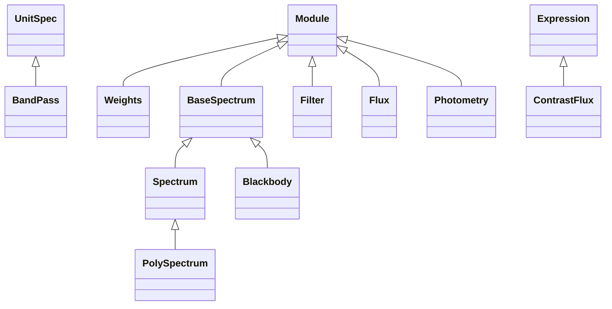

<!-- Generated by docs/scripts/generate_api_mds.py; do not edit. -->

# Photometry

See the [usage overview](../../overviews/utils/photometry/overview.md) for examples.

## Inheritance

???+ info "BandPass"
    ::: dLux.utils.photometry.bandpass.BandPass
        options:
          merge_init_into_class: true
          inherited_members: [__init__]

???+ info "Weights"
    ::: dLux.utils.photometry.weights.Weights
        options:
          merge_init_into_class: true
          inherited_members: [__init__]

???+ info "BaseSpectrum"
    ::: dLux.utils.photometry.spectral.BaseSpectrum
        options:
          merge_init_into_class: true
          inherited_members: [__init__]

???+ info "Spectrum"
    ::: dLux.utils.photometry.spectral.Spectrum
        options:
          merge_init_into_class: true
          inherited_members: [__init__]

???+ info "PolySpectrum"
    ::: dLux.utils.photometry.spectral.PolySpectrum
        options:
          merge_init_into_class: true
          inherited_members: [__init__]

???+ info "Filter"
    ::: dLux.utils.photometry.spectral.Filter
        options:
          merge_init_into_class: true
          inherited_members: [__init__]

???+ info "Blackbody"
    ::: dLux.utils.photometry.spectral.Blackbody
        options:
          merge_init_into_class: true
          inherited_members: [__init__]

???+ info "blackbody"
    ::: dLux.utils.photometry.spectral.blackbody

???+ info "sample_curve"
    ::: dLux.utils.photometry.spectral.sample_curve

???+ info "Flux"
    ::: dLux.utils.photometry.flux.Flux
        options:
          merge_init_into_class: true
          inherited_members: [__init__]

???+ info "ContrastFlux"
    ::: dLux.utils.photometry.flux.ContrastFlux
        options:
          merge_init_into_class: true
          inherited_members: [__init__]

???+ info "flux2mag"
    ::: dLux.utils.photometry.flux.flux2mag

???+ info "mag2flux"
    ::: dLux.utils.photometry.flux.mag2flux

???+ info "integrate_curve"
    ::: dLux.utils.photometry.integration.integrate_curve

???+ info "integrate_spectrum"
    ::: dLux.utils.photometry.integration.integrate_spectrum

???+ info "bin_spectrum"
    ::: dLux.utils.photometry.integration.bin_spectrum

???+ info "Photometry"
    ::: dLux.utils.photometry.photometry.Photometry
        options:
          merge_init_into_class: true
          inherited_members: [__init__]
