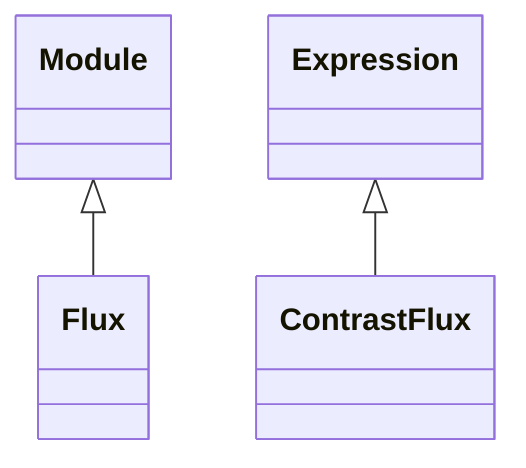

<!-- Generated by docs/scripts/generate_api_mds.py; do not edit. -->

# Photometry / Flux

## Inheritance

???+ info "Flux"
    ::: dLux.utils.photometry.flux.Flux
        options:
          merge_init_into_class: true
          inherited_members: [__init__]

???+ info "ContrastFlux"
    ::: dLux.utils.photometry.flux.ContrastFlux
        options:
          merge_init_into_class: true
          inherited_members: [__init__]

???+ info "flux2mag"
    ::: dLux.utils.photometry.flux.flux2mag

???+ info "mag2flux"
    ::: dLux.utils.photometry.flux.mag2flux
