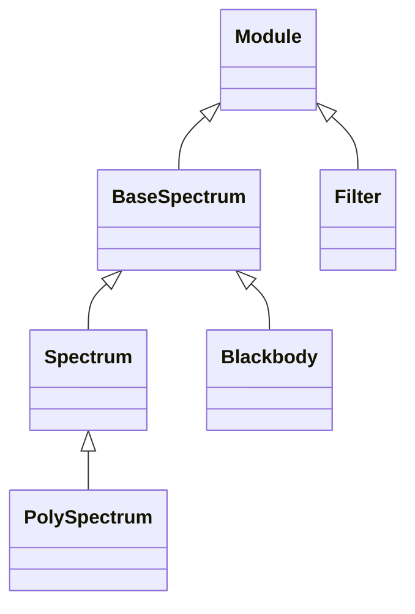

<!-- Generated by docs/scripts/generate_api_mds.py; do not edit. -->

# Photometry / Spectral

## Inheritance

???+ info "BaseSpectrum"
    ::: dLux.utils.photometry.spectral.BaseSpectrum
        options:
          merge_init_into_class: true
          inherited_members: [__init__]

???+ info "Spectrum"
    ::: dLux.utils.photometry.spectral.Spectrum
        options:
          merge_init_into_class: true
          inherited_members: [__init__]

???+ info "PolySpectrum"
    ::: dLux.utils.photometry.spectral.PolySpectrum
        options:
          merge_init_into_class: true
          inherited_members: [__init__]

???+ info "Filter"
    ::: dLux.utils.photometry.spectral.Filter
        options:
          merge_init_into_class: true
          inherited_members: [__init__]

???+ info "Blackbody"
    ::: dLux.utils.photometry.spectral.Blackbody
        options:
          merge_init_into_class: true
          inherited_members: [__init__]

???+ info "blackbody"
    ::: dLux.utils.photometry.spectral.blackbody

???+ info "sample_curve"
    ::: dLux.utils.photometry.spectral.sample_curve
