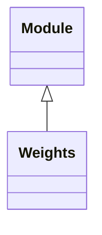

<!-- Generated by docs/scripts/generate_api_mds.py; do not edit. -->

# Photometry / Weights

## Inheritance

???+ info "Weights"
    ::: dLux.utils.photometry.weights.Weights
        options:
          merge_init_into_class: true
          inherited_members: [__init__]
