<!-- Generated by docs/scripts/generate_api_mds.py; do not edit. -->

# Propagation

See the [usage overview](../../overviews/utils/propagation/overview.md) for examples.

## Inheritance

```mermaid
classDiagram
    direction TB
    class dLux_utils_sequential_Series["Series"]
    class dLux_utils_propagation_operations_Resize["Resize"]
    class dLux_utils_propagation_operations_Chirp["Chirp"]
    class dLux_utils_propagation_mft_MFT["MFT"]
    class dLux_utils_propagation_fft_FFT["FFT"]
    class dLux_utils_propagation_asm_ASM["ASM"]
    class dLux_utils_sequential_Sequential["Sequential"]
    class dLux_utils_propagation_propagators_BasePropagator["BasePropagator"]
    class dLux_utils_propagation_propagators_LCT["LCT"]
    class dLux_utils_propagation_propagators_Propagator["Propagator"]
    class dLux_utils_propagation_propagators_FFTPropagator["FFTPropagator"]
    class dLux_utils_propagation_propagators_SpectralPropagator["SpectralPropagator"]
    class dLux_utils_propagation_propagators_FreeSpace["FreeSpace"]
    class dLux_utils_propagation_propagators_ThinPower["ThinPower"]
    class dLux_utils_propagation_abcd_ABCD["ABCD"]
    class dLux_utils_propagation_abcd_ABCDChain["ABCDChain"]
    class dLux_utils_sequential_BaseLayer["BaseLayer"]
    class zodiax_module_Module["Module"]
    class zodiax_numerics_expressions_Expression["Expression"]
    dLux_utils_sequential_Sequential <|-- dLux_utils_sequential_Series
    zodiax_numerics_expressions_Expression <|-- dLux_utils_sequential_Series
    click dLux_utils_sequential_Series href "#dLux.utils.sequential.Series" "Attributes: layers · Methods: evaluate(), __call__()"
    dLux_utils_sequential_BaseLayer <|-- dLux_utils_propagation_operations_Resize
    click dLux_utils_propagation_operations_Resize href "#dLux.utils.propagation.operations.Resize" "Attributes: n · Methods: __init__(), apply()"
    dLux_utils_sequential_BaseLayer <|-- dLux_utils_propagation_operations_Chirp
    click dLux_utils_propagation_operations_Chirp href "#dLux.utils.propagation.operations.Chirp" "Attributes: factors · Properties: n · Methods: __init__(), from_axes(), broadcast(), then(), apply()"
    dLux_utils_sequential_BaseLayer <|-- dLux_utils_propagation_mft_MFT
    click dLux_utils_propagation_mft_MFT href "#dLux.utils.propagation.mft.MFT" "Attributes: kernels · Properties: ndim, batch_shape, n_in, n_out, input_shape, output_shape · Methods: __init__(), broadcast(), apply(), then(), fuse_input(), fuse_output(), fuse_scale(), from_axes(), from_grids()"
    dLux_utils_sequential_BaseLayer <|-- dLux_utils_propagation_fft_FFT
    click dLux_utils_propagation_fft_FFT href "#dLux.utils.propagation.fft.FFT" "Attributes: n, inverse, centered · Properties: n_in, n_out · Methods: __init__(), prepare(), origin(), apply()"
    dLux_utils_sequential_Series <|-- dLux_utils_propagation_asm_ASM
    click dLux_utils_propagation_asm_ASM href "#dLux.utils.propagation.asm.ASM" "Attributes: layers · Methods: __init__()"
    dLux_utils_sequential_BaseLayer <|-- dLux_utils_sequential_Sequential
    click dLux_utils_sequential_Sequential href "#dLux.utils.sequential.Sequential" "Attributes: layers · Properties: steps · Methods: __init__(), apply(), debug(), insert(), remove(), insert_layer(), remove_layer()"
    zodiax_module_Module <|-- dLux_utils_propagation_propagators_BasePropagator
    click dLux_utils_propagation_propagators_BasePropagator href "#dLux.utils.propagation.propagators.BasePropagator" "Methods: __init__(), __call__(), prepare()"
    dLux_utils_propagation_propagators_BasePropagator <|-- dLux_utils_propagation_propagators_LCT
    click dLux_utils_propagation_propagators_LCT href "#dLux.utils.propagation.propagators.LCT" "Attributes: abcd, grid_out · Properties: matrix · Methods: __init__()"
    dLux_utils_propagation_propagators_LCT <|-- dLux_utils_propagation_propagators_Propagator
    click dLux_utils_propagation_propagators_Propagator href "#dLux.utils.propagation.propagators.Propagator" "Attributes: abcd, grid_out, focal_length, defocus, inverse · Properties: matrix · Methods: __init__()"
    dLux_utils_propagation_propagators_Propagator <|-- dLux_utils_propagation_propagators_FFTPropagator
    click dLux_utils_propagation_propagators_FFTPropagator href "#dLux.utils.propagation.propagators.FFTPropagator" "Attributes: abcd, grid_out, focal_length, defocus, inverse · Methods: __init__()"
    dLux_utils_propagation_propagators_LCT <|-- dLux_utils_propagation_propagators_SpectralPropagator
    click dLux_utils_propagation_propagators_SpectralPropagator href "#dLux.utils.propagation.propagators.SpectralPropagator" "Attributes: abcd, grid_freq, grid_out · Methods: __init__()"
    dLux_utils_propagation_propagators_BasePropagator <|-- dLux_utils_propagation_propagators_FreeSpace
    click dLux_utils_propagation_propagators_FreeSpace href "#dLux.utils.propagation.propagators.FreeSpace" "Attributes: distance, resize · Properties: abcd · Methods: __init__()"
    dLux_utils_propagation_propagators_BasePropagator <|-- dLux_utils_propagation_propagators_ThinPower
    click dLux_utils_propagation_propagators_ThinPower href "#dLux.utils.propagation.propagators.ThinPower" "Attributes: power · Methods: __init__()"
    zodiax_numerics_expressions_Expression <|-- dLux_utils_propagation_abcd_ABCD
    click dLux_utils_propagation_abcd_ABCD href "#dLux.utils.propagation.abcd.ABCD" "Attributes: matrix, free_space, lens, power, radius, fraunhofer · Properties: a, b, c, d, determinant, effective_focal_length, paraxial_power, geometric_magnification, angular_magnification, distance, front_focal_length, back_focal_length · Methods: __init__(), evaluate(), is_surface(), is_free_space(), is_unimodular(), inverse(), then(), identity(), validate()"
    zodiax_numerics_expressions_Expression <|-- dLux_utils_propagation_abcd_ABCDChain
    click dLux_utils_propagation_abcd_ABCDChain href "#dLux.utils.propagation.abcd.ABCDChain" "Attributes: elements · Methods: __init__(), evaluate(), then(), inverse()"
```

???+ info "Series"
    ::: dLux.utils.sequential.Series
        options:
          merge_init_into_class: true
          inherited_members: [__init__, __call__, apply, matrix]

???+ info "Resize"
    ::: dLux.utils.propagation.operations.Resize
        options:
          merge_init_into_class: true
          inherited_members: [__init__, __call__, apply, matrix]

???+ info "Chirp"
    ::: dLux.utils.propagation.operations.Chirp
        options:
          merge_init_into_class: true
          inherited_members: [__init__, __call__, apply, matrix]

???+ info "MFT"
    ::: dLux.utils.propagation.mft.MFT
        options:
          merge_init_into_class: true
          inherited_members: [__init__, __call__, apply, matrix]

???+ info "FFT"
    ::: dLux.utils.propagation.fft.FFT
        options:
          merge_init_into_class: true
          inherited_members: [__init__, __call__, apply, matrix]

???+ info "ASM"
    ::: dLux.utils.propagation.asm.ASM
        options:
          merge_init_into_class: true
          inherited_members: [__init__, __call__, apply, matrix]

???+ info "fourier_shift"
    ::: dLux.utils.propagation.fft.fourier_shift

???+ info "Sequential"
    ::: dLux.utils.sequential.Sequential
        options:
          merge_init_into_class: true
          inherited_members: [__init__, __call__, apply, matrix]

???+ info "mft_kernel"
    ::: dLux.utils.propagation.mft.mft_kernel

???+ info "mft_kernels"
    ::: dLux.utils.propagation.mft.mft_kernels

???+ info "mft_phase_parameter"
    ::: dLux.utils.propagation.mft.mft_phase_parameter

???+ info "mft_sampling_parameter"
    ::: dLux.utils.propagation.mft.mft_sampling_parameter

???+ info "BasePropagator"
    ::: dLux.utils.propagation.propagators.BasePropagator
        options:
          merge_init_into_class: true
          inherited_members: [__init__, __call__, apply, matrix]

???+ info "LCT"
    ::: dLux.utils.propagation.propagators.LCT
        options:
          merge_init_into_class: true
          inherited_members: [__init__, __call__, apply, matrix]

???+ info "Propagator"
    ::: dLux.utils.propagation.propagators.Propagator
        options:
          merge_init_into_class: true
          inherited_members: [__init__, __call__, apply, matrix]

???+ info "FFTPropagator"
    ::: dLux.utils.propagation.propagators.FFTPropagator
        options:
          merge_init_into_class: true
          inherited_members: [__init__, __call__, apply, matrix]

???+ info "SpectralPropagator"
    ::: dLux.utils.propagation.propagators.SpectralPropagator
        options:
          merge_init_into_class: true
          inherited_members: [__init__, __call__, apply, matrix]

???+ info "FreeSpace"
    ::: dLux.utils.propagation.propagators.FreeSpace
        options:
          merge_init_into_class: true
          inherited_members: [__init__, __call__, apply, matrix]

???+ info "ThinPower"
    ::: dLux.utils.propagation.propagators.ThinPower
        options:
          merge_init_into_class: true
          inherited_members: [__init__, __call__, apply, matrix]

???+ info "ABCD"
    ::: dLux.utils.propagation.abcd.ABCD
        options:
          merge_init_into_class: true
          inherited_members: [__init__, __call__, apply, matrix]

???+ info "ABCDChain"
    ::: dLux.utils.propagation.abcd.ABCDChain
        options:
          merge_init_into_class: true
          inherited_members: [__init__, __call__, apply, matrix]

???+ info "abcd_determinant"
    ::: dLux.utils.propagation.abcd.abcd_determinant

???+ info "abcd_is_unimodular"
    ::: dLux.utils.propagation.abcd.abcd_is_unimodular
