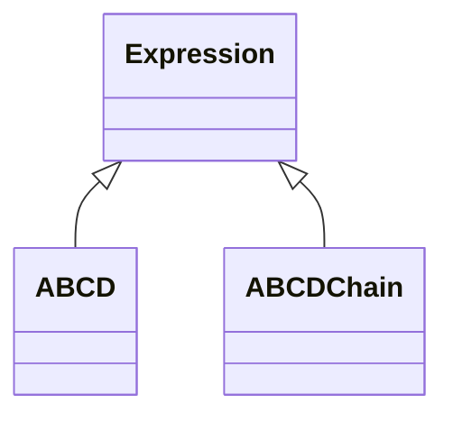

<!-- Generated by docs/scripts/generate_api_mds.py; do not edit. -->

# Propagation / ABCD

## Inheritance

???+ info "ABCD"
    ::: dLux.utils.propagation.abcd.ABCD
        options:
          merge_init_into_class: true
          inherited_members: [__init__, __call__, apply, matrix]

???+ info "ABCDChain"
    ::: dLux.utils.propagation.abcd.ABCDChain
        options:
          merge_init_into_class: true
          inherited_members: [__init__, __call__, apply, matrix]

???+ info "abcd_determinant"
    ::: dLux.utils.propagation.abcd.abcd_determinant

???+ info "abcd_is_unimodular"
    ::: dLux.utils.propagation.abcd.abcd_is_unimodular
