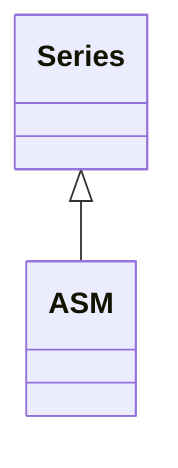

<!-- Generated by docs/scripts/generate_api_mds.py; do not edit. -->

# Propagation / Asm

## Inheritance

???+ info "ASM"
    ::: dLux.utils.propagation.asm.ASM
        options:
          merge_init_into_class: true
          inherited_members: [__init__, __call__, apply, matrix]
