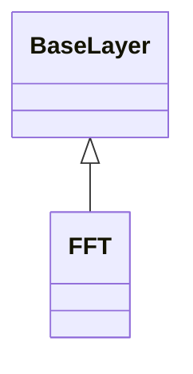

<!-- Generated by docs/scripts/generate_api_mds.py; do not edit. -->

# Propagation / FFT

## Inheritance

???+ info "FFT"
    ::: dLux.utils.propagation.fft.FFT
        options:
          merge_init_into_class: true
          inherited_members: [__init__, __call__, apply, matrix]

???+ info "fourier_shift"
    ::: dLux.utils.propagation.fft.fourier_shift
