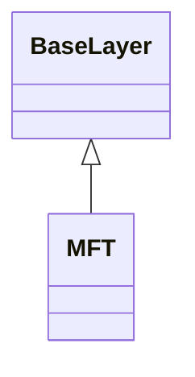

<!-- Generated by docs/scripts/generate_api_mds.py; do not edit. -->

# Propagation / MFT

## Inheritance

???+ info "MFT"
    ::: dLux.utils.propagation.mft.MFT
        options:
          merge_init_into_class: true
          inherited_members: [__init__, __call__, apply, matrix]

???+ info "mft_kernel"
    ::: dLux.utils.propagation.mft.mft_kernel

???+ info "mft_kernels"
    ::: dLux.utils.propagation.mft.mft_kernels

???+ info "mft_phase_parameter"
    ::: dLux.utils.propagation.mft.mft_phase_parameter

???+ info "mft_sampling_parameter"
    ::: dLux.utils.propagation.mft.mft_sampling_parameter
