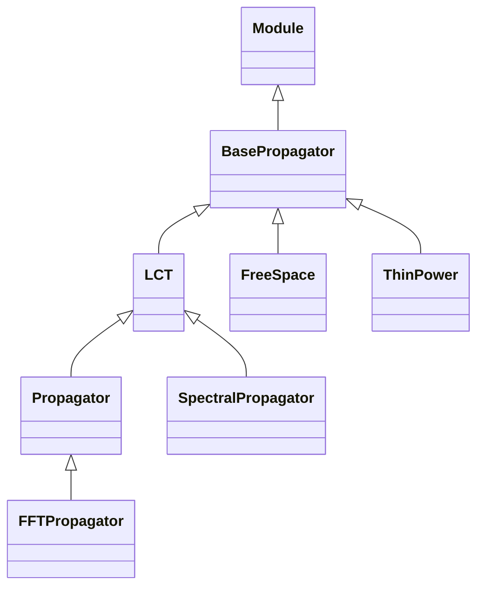

<!-- Generated by docs/scripts/generate_api_mds.py; do not edit. -->

# Propagation / Propagators

## Inheritance

???+ info "BasePropagator"
    ::: dLux.utils.propagation.propagators.BasePropagator
        options:
          merge_init_into_class: true
          inherited_members: [__init__, __call__, apply, matrix]

???+ info "LCT"
    ::: dLux.utils.propagation.propagators.LCT
        options:
          merge_init_into_class: true
          inherited_members: [__init__, __call__, apply, matrix]

???+ info "Propagator"
    ::: dLux.utils.propagation.propagators.Propagator
        options:
          merge_init_into_class: true
          inherited_members: [__init__, __call__, apply, matrix]

???+ info "FFTPropagator"
    ::: dLux.utils.propagation.propagators.FFTPropagator
        options:
          merge_init_into_class: true
          inherited_members: [__init__, __call__, apply, matrix]

???+ info "FreeSpace"
    ::: dLux.utils.propagation.propagators.FreeSpace
        options:
          merge_init_into_class: true
          inherited_members: [__init__, __call__, apply, matrix]

???+ info "SpectralPropagator"
    ::: dLux.utils.propagation.propagators.SpectralPropagator
        options:
          merge_init_into_class: true
          inherited_members: [__init__, __call__, apply, matrix]

???+ info "ThinPower"
    ::: dLux.utils.propagation.propagators.ThinPower
        options:
          merge_init_into_class: true
          inherited_members: [__init__, __call__, apply, matrix]
