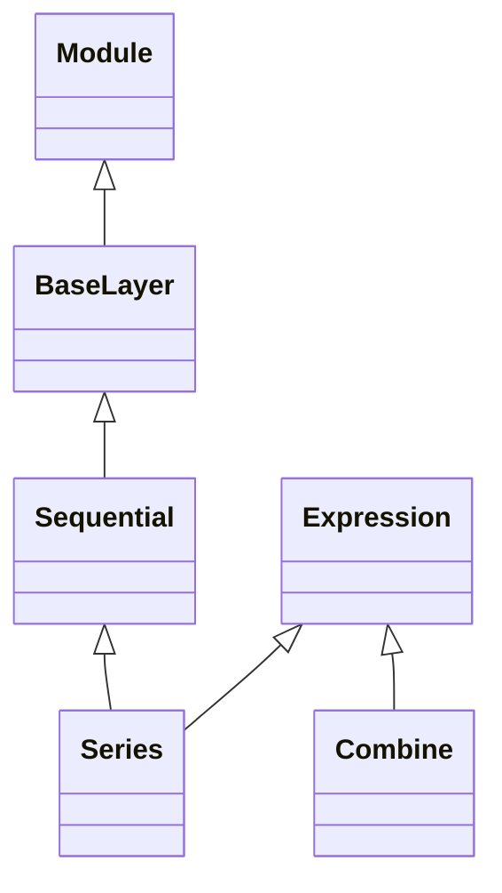

<!-- Generated by docs/scripts/generate_api_mds.py; do not edit. -->

# Sequential

## Inheritance

???+ info "list2dictionary"
    ::: dLux.utils.sequential.list2dictionary

???+ info "insert_layer"
    ::: dLux.utils.sequential.insert_layer

???+ info "remove_layer"
    ::: dLux.utils.sequential.remove_layer

???+ info "BaseLayer"
    ::: dLux.utils.sequential.BaseLayer
        options:
          merge_init_into_class: true
          inherited_members: [__init__]

???+ info "Sequential"
    ::: dLux.utils.sequential.Sequential
        options:
          merge_init_into_class: true
          inherited_members: [__init__]

???+ info "Series"
    ::: dLux.utils.sequential.Series
        options:
          merge_init_into_class: true
          inherited_members: [__init__]

???+ info "Combine"
    ::: dLux.utils.sequential.Combine
        options:
          merge_init_into_class: true
          inherited_members: [__init__]
