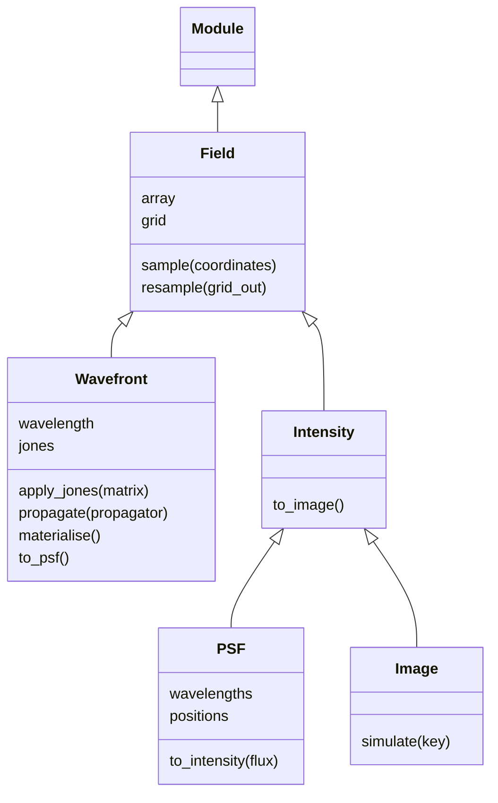

# Fields

## 1. Carry an optical field through a pupil

A `Wavefront` stores complex samples, their grid and the wavelength. Optical layers
return another Wavefront with the same sampling unless they explicitly propagate it.

```python
import dLux as dl
import dLux.utils as dlu

pupil_grid = dlu.Grid(n=8, diam=1.0, unit="m")
wavefront = dl.Wavefront(600e-9, pupil_grid)
pupil = dl.Optic(transmission=dlu.Circle(0.8), normalise=True)
wavefront = pupil(wavefront)
print(wavefront)
```

```text
Wavefront(
  array=c64[8,8], grid=Grid(unit='m', n=(8, 8), d=f32[2]), wavelength=f32[]
)
```

The initial Wavefront has unit power. The pupil evaluates its circular transmission
on that grid and normalises the transmitted field because `normalise=True`.

```python
image_grid = dlu.Grid(n=10, d=0.1, unit="arcsec")
focus = dl.PropagatorLayer(image_grid)
focused = focus(wavefront)
print(focused.to_psf())
```

```text
PSF(
  array=f32[10,10],
  grid=Grid(unit='arcsec', n=(10, 10), d=f32[2]),
  wavelengths=f32[]
)
```

A PSF is the unweighted optical point response. A wavelength vector would retain a
leading wavelength axis; conversion does not integrate over it.

## 2. Form a signal and detect it

For one point response, `to_intensity` applies a photon scale. Detector then applies
its response, integrates pixels and produces an Image.

```python
signal = focused.to_psf().to_intensity(flux=1000)
detector = dl.Detector(gain=2, downsample=2)
print(signal)
print(detector(signal))
```

```text
Intensity(array=f32[10,10], grid=Grid(unit='arcsec', n=(10, 10), d=f32[2]))
Image(array=f32[5,5], grid=Grid(unit='arcsec', n=(5, 5), d=f32[2]))
```

`Intensity` contains expected signal; `Image` contains detector samples, either
expected or simulated. Neither stores its source or a noise model. Imager handles
spectral weights and multiple sources when those operations are needed.

## 3. Resample while retaining field metadata

Field sampling uses the common Interp engine. Resampling returns the same kind of
field on the new grid, whereas `sample(coordinates)` returns an array.

```python
resampled = focused.resample(dlu.Grid(n=12, d=0.08, unit="arcsec"))
print(resampled)
```

```text
Wavefront(
  array=c64[12,12],
  grid=Grid(unit='arcsec', n=(12, 12), d=f32[2]),
  wavelength=f32[]
)
```

Wavefront resampling interpolates real and imaginary amplitudes without applying
pixel-area or flux corrections. Interpolating a PSF acts on intensity samples.
These operations differ; Imager uses complex sampling before detection.

## 4. Keep uniform polarisation compact

A uniform Jones response stays separate from the spatial amplitudes. Spatially
varying responses use explicit Jones axes in the array.

```python
matrix = dlu.Jones.HalfWavePlate(angle=0.2).resolve()
polarised = wavefront.apply_jones(matrix)
print(polarised)
print(polarised.materialise())
```

```text
Wavefront(
  array=c64[8,8],
  grid=Grid(unit='m', n=(8, 8), d=f32[2]),
  wavelength=f32[],
  jones=c64[2,2]
)
Wavefront(
  array=c64[2,2,8,8],
  grid=Grid(unit='m', n=(8, 8), d=f32[2]),
  wavelength=f32[],
  jones=True
)
```

Intensity calculations include either representation. The stored `array` of a
compact Wavefront contains only its scalar factor; `materialise()` includes the
Jones response in every spatial sample.

## Class and array contracts



| Operation or value | Contract |
|---|---|
| `dlu.Field(array, grid)` | Real/complex samples with trailing `grid.shape` axes |
| `Wavefront.phasor` | Complex `(..., y, x)`; explicit Jones samples use `(..., 2, 2, y, x)` |
| `Wavefront.jones` | `None`, compact `(..., 2, 2)` array, or `True` |
| `Wavefront.to_psf()` | PSF retaining wavelength axes, without photometric weights |
| `PSF.to_intensity(flux)` | Scale each leading response independently; no spectral sum |
| `Intensity.to_image()` | Wrap the samples; no detector operations or noise |
| `Image.simulate(key, n_frames, read_noise=...)` | Mean of independent Poisson/read-noise frames |

All four classes inherit immutable sampling and array operations from Field. They
store sampled results, not a connection back to the model that produced them.
