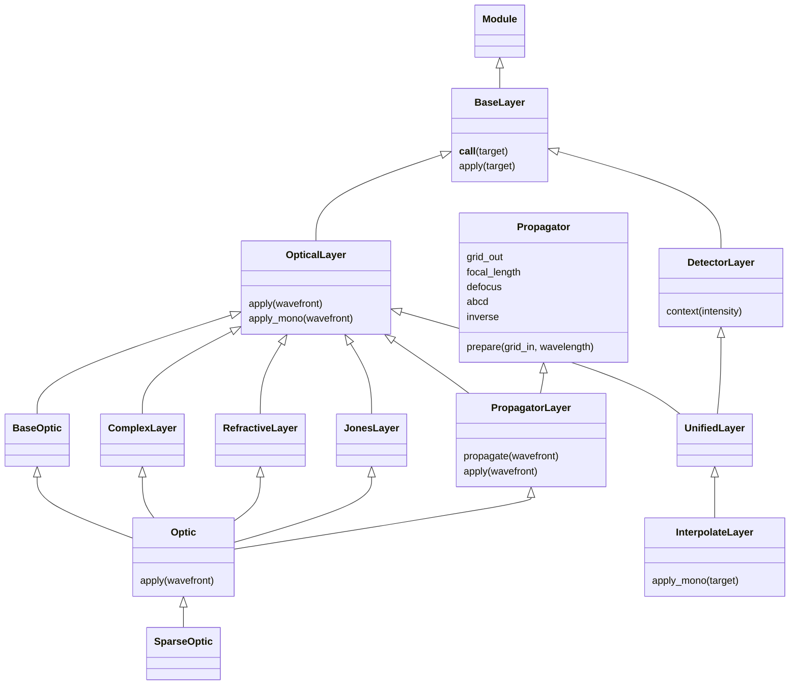

# Layers

Layers apply physical or sampling operations to fields. An Optic applies local
effects, then optionally propagates the field to an output grid.

## 1. Applying an optic

An optical layer supplies the coordinates needed by its numerical definitions.

```python
import dLux as dl
import dLux.utils as dlu

wavefront = dl.Wavefront(600e-9, dlu.Grid(8, diam=1.2, unit="m"))
optic = dl.Optic(transmission=dlu.Circle(1.0), normalise=True)
print(optic)
print(optic(wavefront))
```

```text
Optic(transmission=Circle(diameter=f32[]), normalise=True)
Wavefront(
  array=c64[8,8], grid=Grid(unit='m', n=(8, 8), d=f32[2]), wavelength=f32[]
)
```

Transmission can instead be an array on that grid. OPD, phase, material thickness
and index follow the same array-or-definition approach. `jones` accepts numerical
Jones definitions or arrays. The [optical guide](../utils/optical/overview.md)
introduces those definitions independently.

Optic inherits BaseOptic, ComplexLayer, RefractiveLayer, JonesLayer and
PropagatorLayer. Their numerical leaves stay directly on the optic; immutable
updates use paths such as `opd.coeffs`, `phase`, `thickness` or `jones`.
Each parent layer can also be used independently. With `grid_out=None`, Optic
applies only its local effects. Supplying an output grid then propagates the
resulting field after scalar and Jones operations.

`normalise=True` sets transmitted power to one at this plane. This is useful for
an entrance pupil; later transmission losses can remain unnormalised. Optional
grid/transform settings affect expression evaluation, not the sampling of an
already supplied array. `focal_length`, `defocus`, `abcd` and `inverse` configure
the inherited relay; they do not add a separate local thin-lens phase.

## 2. Propagating to another plane

PropagatorLayer inherits the numerical Propagator parameters and adds Wavefront
input and output. The relay parameters remain directly on the object.

```python
image_grid = dlu.Grid(8, d=0.1, unit="arcsec")
relay = dl.PropagatorLayer(image_grid)
print(relay)
print(relay(optic(wavefront)))
```

```text
PropagatorLayer(grid_out=Grid(unit='arcsec', n=(8, 8), d=f32[2]))
Wavefront(
  array=c64[8,8], grid=Grid(unit='arcsec', n=(8, 8), d=f32[2]), wavelength=f32[]
)
```

The constructor also accepts `focal_length`, `defocus`, `abcd` and `inverse`.
For another numerical algorithm, use `wavefront.propagate(dlu.FFTPropagator(...))`,
`wavefront.propagate(dlu.FreeSpace(...))` or a SpectralPropagator. Wavefront aligns
wavelength, population and Jones axes and retains the resulting output grid.
The numerical [propagation guide](../utils/propagation/overview.md) explains
explicit preparation.

`dl.Sequential({"pupil": optic, "image": relay})(wavefront)` applies named layers
in order. OpticalSystem also accepts numerical propagators directly as named
steps. Imager owns the modelling route when sources and detection are needed.

## 3. Repeated apertures

SparseOptic evaluates local aperture fields, retaining an aperture axis until the
fields are coherently summed.

```python
sparse = dl.SparseOptic(
    centers=[[-0.2, 0.0], [0.2, 0.0]],
    transmission=dlu.Circle(0.2),
    normalise=True,
)
local = dl.Wavefront(600e-9, dlu.Grid(8, diam=0.25, unit="m"))
print(sparse)
print(sparse(local).phasor.shape)
```

```text
SparseOptic(
  transmission=Circle(diameter=f32[]), normalise=True, centers=f32[2,2]
)
(2, 8, 8)
```

The grid samples each local patch. Interferometer propagates those patches and
sums their complex fields. Sources are summed in intensity instead.

| Sparse input | Meaning |
| --- | --- |
| Scalar or `(ny, nx)` optical values | Shared by every aperture |
| `(apertures, ny, nx)` optical values | One sampled array per aperture |
| Basis coefficients with intrinsic shape | Shared expansion |
| `(apertures, *coefficient_shape)` | Independent aperture coefficients |
| Shared outer transform | Maps coordinates before aperture placement |
| Aperture-dependent outer transform | Maps each local aperture frame |

`ParametricBasis.coeffs_ndim` identifies intrinsic coefficient axes. The current
transform selection supports Affine, AffineMap and Distortion; arbitrary custom
batched transforms require a further extension contract. Local Jones terms are
not supported by SparseOptic; a separate Optic can apply them.

## 4. Sampling and detector adapters

InterpolateLayer applies a coordinate transform while retaining a field's output grid.
Field supplies complex/Jones handling, and Interp supplies the interpolation.

```python
rotation = dl.InterpolateLayer(dlu.Affine(rotation=0.1))
rotated = rotation(optic(wavefront))
print(rotated)
```

```text
Wavefront(
  array=c64[8,8], grid=Grid(unit='m', n=(8, 8), d=f32[2]), wavelength=f32[]
)
```

Use field `resample` when the output grid itself changes. Detector layers instead
act on expected intensity; Detector owns pixel integration, noise and gain.
See the [field](../fields/overview.md) and [system](../systems/overview.md) guides.

## Inheritance and extension contracts

The propagation branch is `dlu.Propagator` → `dl.PropagatorLayer` → `dl.Optic`.



| Contract | Input → output | Owner |
| --- | --- | --- |
| `BaseLayer.apply` | Compatible target → transformed target | Subclass implements the operation; calling delegates to it |
| `OpticalLayer.apply_mono` | One monochromatic Wavefront → Wavefront | Inherited apply maps wavelengths and populations |
| `DetectorLayer.apply` | Intensity → Intensity | Retains compatible leading axes |
| `UnifiedLayer.apply_mono` | Wavefront or Intensity → same field type | Shared operation with field-specific semantics |
| `PropagatorLayer.apply` | Complete Wavefront → propagated Wavefront | Inherited relay parameters; Wavefront owns axis alignment |
| `Optic.apply` | Complete Wavefront → transformed Wavefront | Local scalar/Jones effects, then propagation when `grid_out` is supplied |

Layers pass caller context to numerical definitions. Optic uses local coordinates,
pixel scale and metre wavelengths; detector operations use the incident grid.
Resolve a definition where its own required sampling is available.
