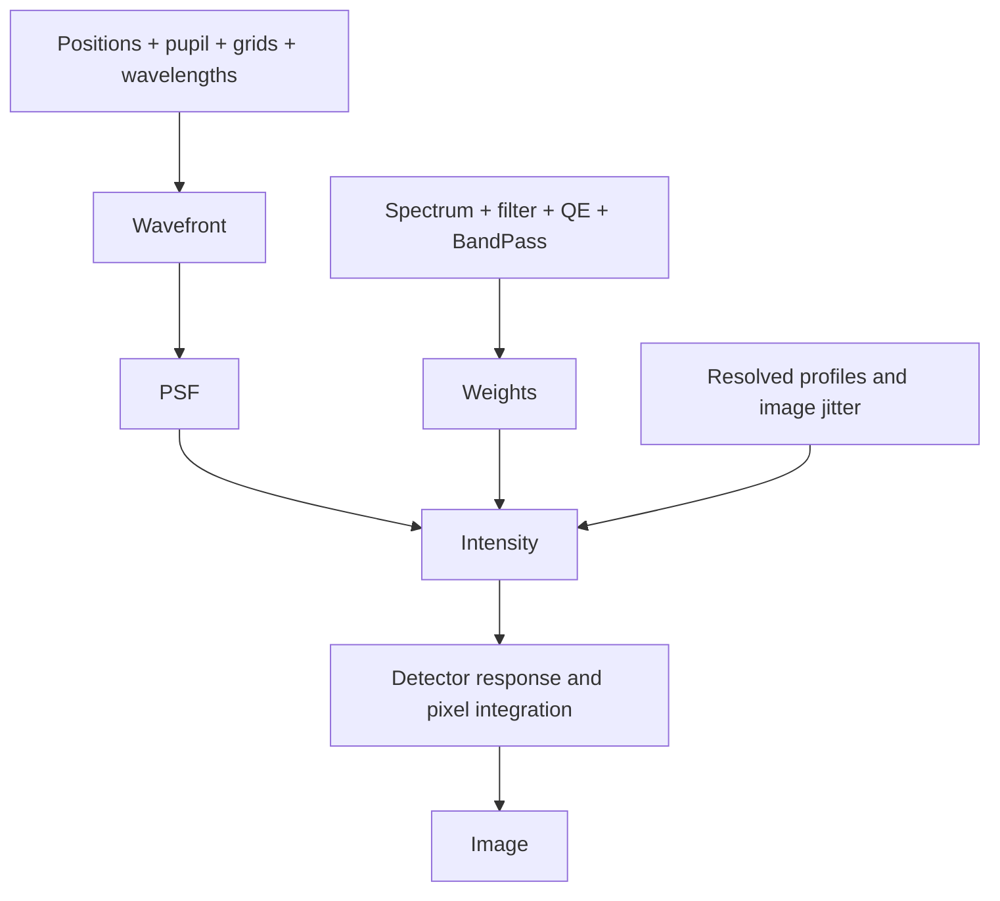

# Image formation

## 1. Build an image

An Imager combines an optical pupil, a source and detector sampling. Its pupil can
hold sampled arrays or definitions that generate those arrays on the pupil grid.

```python
import dLux as dl

imager = dl.Imager(
    pupil_grid=dl.Grid(16, diam=1.0, unit="m"),
    image_grid=dl.Grid(8, d=0.1, unit="arcsec"),
    pupil=dl.Optic(transmission=dl.Circle(1.0), normalise=True),
    source=dl.PointSource(flux=1000),
    bandpass=dl.BandPass(range=(550, 650), n=3, unit="nm"),
    oversample=2,
)
print(imager.model())
```

```text
Image(array=f32[8,8], grid=Grid(unit='arcsec', n=(8, 8), d=f32[2]))
```

`image_grid` describes the final pixels. Optical oversampling calculates a finer
response before pixel integration. Pupil normalisation sets the transmitted power
to one; subsequent optical, filter and detector losses retain their scale.

## 2. Inspect the intermediate results

The same model exposes the stages used to form the image.

```python
print(imager.psf())
print(imager.photometry())
print(imager.intensity())
```

```text
PSF(
  array=f32[1,3,16,16],
  grid=Grid(unit='arcsec', n=(16, 16), d=f32[2]),
  wavelengths=f32[3],
  positions=f32[1,2]
)
Weights(value=f32[1,3], bandpass=BandPass(unit='nm', range=(550.0, 650.0), n=3))
Intensity(array=f32[16,16], grid=Grid(unit='arcsec', n=(16, 16), d=f32[2]))
```

The PSF contains optical responses for each source position and wavelength, without
source brightness. Photometry integrates the source spectrum and responses into
photon counts for those wavelengths. Intensity combines them before detection.



## 3. Reuse the model

Method arguments override stored inputs for one calculation, without changing the model.
PointSource positions default to arcseconds.

```python
companion = dl.PointSource(position=[0.2, 0.0], flux=200)
print(imager.model(source=companion))
```

```text
Image(array=f32[8,8], grid=Grid(unit='arcsec', n=(8, 8), d=f32[2]))
```

A list of sources adds their intensities; dictionaries select named independent
outputs. The [systems overview](systems/overview.md) shows both patterns.

## Module responsibilities

| Module | Main input → output |
| --- | --- |
| [Fields](fields/overview.md) | Samples + sampling → Wavefront, PSF, Intensity or Image |
| [Layers](layers/overview.md) | Field → transformed field |
| [Prebuilt](prebuilt/overview.md) | Geometry + pupil grid → Optic or SparseOptic |
| [Systems](systems/overview.md) | Optics + illumination + detector → Image |
| [Utils](utils/overview.md) | Numerical definitions and arrays → arrays |

The [API maps](../API/overview.md) show the complete current inheritance and public methods.
