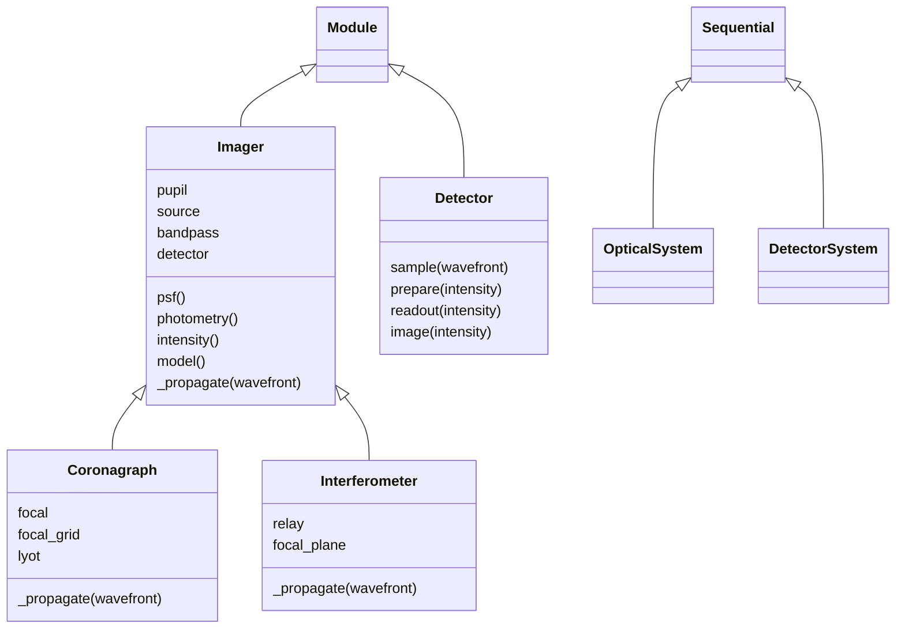

# Imaging systems

## 1. Inspect one model at each stage

Imager exposes optical responses, photometric weights and detector outputs from the
same stored model. Method arguments can replace those inputs for one calculation.

```python
import dLux as dl
import dLux.utils as dlu

imager = dl.Imager(
    pupil_grid=dlu.Grid(n=16, diam=1.0, unit="m"),
    image_grid=dlu.Grid(n=8, d=0.1, unit="arcsec"),
    pupil=dl.Optic(transmission=dlu.Circle(1.0), normalise=True),
    source=dl.PointSource(flux=1000),
    bandpass=dlu.BandPass(range=(550, 650), n=3, unit="nm"),
    oversample=2,
)
print(imager.psf())
print(imager.photometry())
print(imager.model())
```

```text
PSF(
  array=f32[1,3,16,16],
  grid=Grid(unit='arcsec', n=(16, 16), d=f32[2]),
  wavelengths=f32[3],
  positions=f32[1,2]
)
Weights(value=f32[1,3], bandpass=BandPass(unit='nm', range=(550.0, 650.0), n=3))
Image(array=f32[8,8], grid=Grid(unit='arcsec', n=(8, 8), d=f32[2]))
```

`psf()` has no brightness, filter or detector weighting. `photometry()` calculates
those weights without optical propagation. `intensity()` combines them, then
`model()` applies detector response and integrates the optical subpixels.

BandPass's `n` sets the number of optical wavelengths. Spectrum, Filter and QE
may retain finer native sampling; Photometry integrates their product into those
optical bins. An explicit wavelength array is also accepted for `wavefront` and
`psf`, but photometric and image calculations require a BandPass.

## 2. Add sources or calculate independent outputs

A source list adds incoherent contributions before detection. A Scene adds names
and optional shared position offsets to that same operation.

```python
companion = dl.PointSource(position=[0.2, 0], flux=200)
combined = imager.model(source=[imager.source, companion])
print(combined)
```

```text
Image(array=f32[8,8], grid=Grid(unit='arcsec', n=(8, 8), d=f32[2]))
```

Dictionaries passed as modelling inputs instead name separate calculations. Matching
names pair; scalar inputs are shared, and missing names use stored defaults.

```python
images = imager.model(
    filter={"blue": dlu.Filter(0.7), "red": dlu.Filter(0.9)},
    bandpass={"blue": dlu.BandPass(500e-9), "red": dlu.BandPass(700e-9)},
)
print(images["blue"])
print(images["red"])
```

```text
Image(array=f32[8,8], grid=Grid(unit='arcsec', n=(8, 8), d=f32[2]))
Image(array=f32[8,8], grid=Grid(unit='arcsec', n=(8, 8), d=f32[2]))
```

Each channel runs its own optical model. This API does not imply a shared propagation
cache. Passing `None` retains a stored input; use an immutable update to clear one.

## 3. Put detector operations in their physical order

Detector owns sampling and readout settings. Its spectral QE enters photometry;
its response layers act on expected intensity; noise and gain act after integration.

```python
import jax.random as jr

detector = dl.Detector(qe=0.8, read_noise=2.0, gain=0.5)
print(detector)
print(imager.model(detector=detector))
print(imager.simulate(jr.key(0), detector=detector, n_frames=3))
```

```text
Detector(layers={}, qe=f32[], read_noise=f32[], gain=f32[], downsample=(1, 1))
Image(array=f32[8,8], grid=Grid(unit='arcsec', n=(8, 8), d=f32[2]))
Image(array=f32[8,8], grid=Grid(unit='arcsec', n=(8, 8), d=f32[2]))
```

| Step | Input → output | Owner |
|---|---|---|
| Spectral response | Incident masses → photoelectron weights | Photometry, including Detector.qe |
| Optional spatial sampling | Wavefront → Wavefront | `Detector.sample`; Interp performs the calculation |
| Combine responses | PSF + weights → fine Intensity | Imager; source profiles enter here |
| Add source contributions and jitter | Intensities → Intensity | Imager, once for the combined signal |
| Response and pixel integration | Fine Intensity → pixel Intensity | `Detector.prepare` |
| Photon/read noise | Expected pixels → sampled pixels | Image.simulate, used by Detector |
| Gain | Electrons → output units | `Detector.readout` |

`Detector(resample=dlu.Interp(...))` needs complex fields, so Imager calls it while
forming intensity. Calling `detector.image(intensity)` directly starts after that
sampling step. It does not apply spectral QE again. Resolved-source convolution
occurs before complex resampling; reconstructing an effective field retains the
point-response phase and uses the broadened intensity for its amplitude.

## Live definitions and prepared results

An Imager stores definitions. Changing pupil coefficients, source parameters or
grids changes the next calculation. Its `propagator` property derives a relay from
the current image grid and the pupil's inherited `focal_length`, `defocus`, `abcd`
and `inverse` parameters; no persistent propagation cache is stored. Imager owns
`image_grid`, so its pupil and other local-plane slots require `grid_out=None`.
An active output grid there is rejected to avoid propagating twice.

Numerical `Propagator.prepare` returns an operation for particular sampling and
parameters. `Interp.prepare` returns a snapshot of its source samples. Re-prepare
when those inputs change, and prepare inside a differentiated function when fitting
them. JIT compiles the calculation without turning numerical parameters into constants.

`Detector.prepare` currently has a different meaning: it applies response layers and
integrates an Intensity immediately. It returns sampled signal, not a reusable operator.

## Extension and stage contracts



Coronagraph adds a compact focal mask and Lyot plane. Interferometer combines sparse
aperture fields coherently. OpticalSystem and DetectorSystem are standalone
sequences; they do not own source modelling or detector simulation. OpticalSystem
accepts optical layers and numerical propagators as explicit named steps.

| Internal stage | Direct inputs → result |
|---|---|
| `_wavefront` | Metre wavelengths `(L,)`, radian positions `(C, 2)` → Wavefront |
| `_psf` | Wavefront, positions, optional Stokes vector → PSF `(C, L, y, x)` |
| `_photometry` | Source, BandPass, filter and QE → Weights `(C, L)` |
| `_intensity` | PSF, weights, optional profile, Wavefront and Detector → Intensity `(y, x)` |
| `_image` | Summed Intensity and Detector → Image |

Public methods select optional model overrides and named outputs. The private stages
implement one calculation with the selected inputs. Their outputs are sampled results;
they do not update or cache data on the Imager. [Prebuilt pupils](../prebuilt/overview.md) return ordinary Optic or SparseOptic
objects for the pupil slot; they do not construct Imagers.
