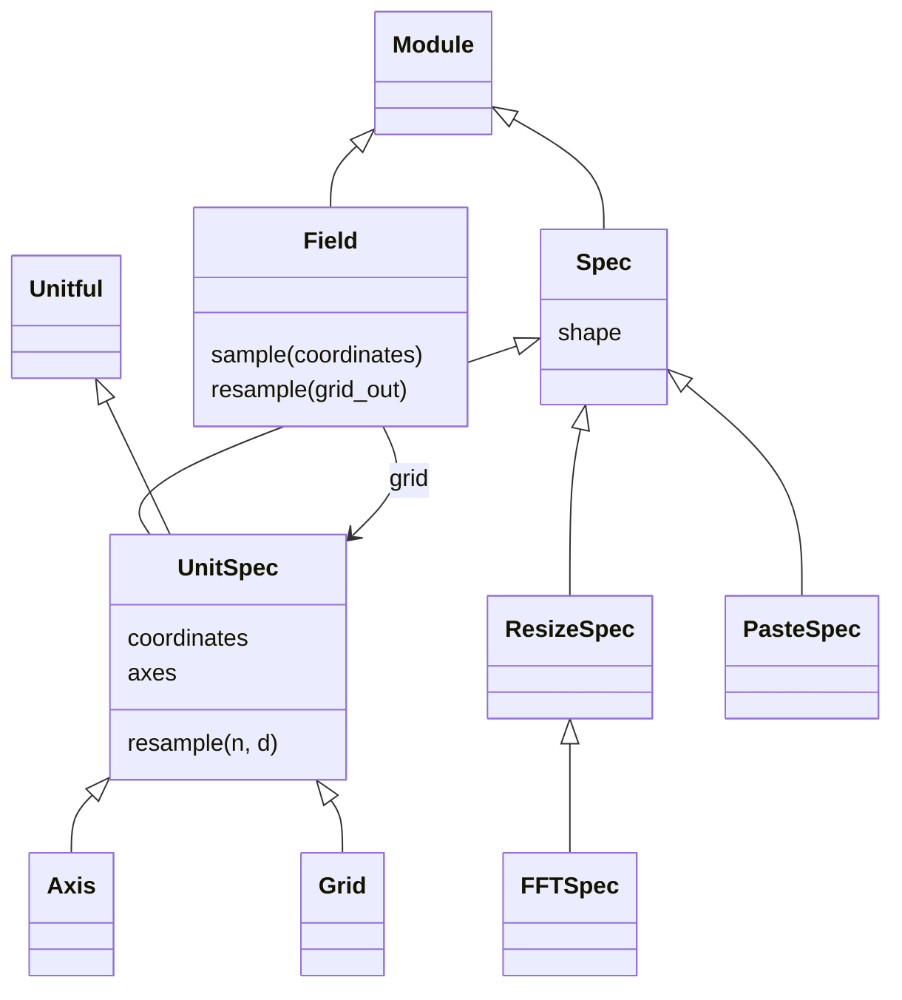

# Grids and sampled fields

## 1. Specify coordinates

Grid describes two spatial dimensions; Axis describes one. Counts and coordinate
components use physical `(x, y)` order, while arrays end in `(ny, nx)`.

```python
import dLux as dl
import jax.numpy as np

grid = dl.Grid(8, diam=1.0, unit="m")
axis = dl.Axis(n=5, d=10, c=600, unit="nm")
print(grid)
print(grid.coordinates.shape)
print(axis)
```

```text
Grid(unit='m', n=(8, 8), d=f32[2])
(2, 8, 8)
Axis(unit='nm', n=(5,), d=f32[1], c=f32[1])
```

A scalar count or spacing applies to both Grid axes. `diam` is the full cell extent,
so spacing is `diam / n`. Stored `d` and `c` use the declared unit; `coordinates`
and `axes` return SI values. Missing counts or spacing may be filled by a consuming
operation, but generating coordinates requires complete sampling.

## 2. Keep values and coordinates together

Field carries a real or complex array and its sampling. It provides component views
and interpolation without assigning physical meanings to the values.

```python
values = dl.Gaussian(std=0.2, grid=grid).resolve()
field = dl.Field(values, grid)
print(field)
print(field.resample(dl.Grid(12, diam=1.0, unit="m")))
print(field.sample((0.0, 0.0)))
```

```text
Field(array=f32[8,8], grid=Grid(unit='m', n=(8, 8), d=f32[2]))
Field(array=f32[12,12], grid=Grid(unit='m', n=(12, 12), d=f32[2]))
0.9967546
```

`sample` returns array values; `resample` returns the same field type on new sampling.
`real`, `imag`, `amplitude`, `phase` and `intensity` also work for real arrays.
Leading array axes remain batches. Axis-backed fields support interpolation, centred
padding, block reduction and convolution as well as two-dimensional fields.

## 3. Move a definition or interpolate an array

Affine maps output coordinates into the object's input frame. The same transform
can act on a geometric definition or on queries into a sampled field.

```python
mapping = dl.Affine(translation=(0.1, 0.0), rotation=0.2)
print(mapping)
print(field.resample(dl.Interp(transform=mapping)))
```

```text
Affine(
  translation=f32[2],
  rotation=f32[],
  order=('translation', 'rotation', 'scale', 'shear')
)
Field(array=f32[8,8], grid=Grid(unit='m', n=(8, 8), d=f32[2]))
```

Positive rotation rotates coordinates anticlockwise and the sampled object clockwise
in physical `(x, y)`. Displaying rows downward can reverse its apparent direction.
Transforming a Circle evaluates new coordinates; transforming a Field interpolates
existing values.

| Mapping | Purpose |
| --- | --- |
| Affine | Translation, rotation, scale and shear in a specified order |
| AffineMap | Direct coordinate matrix and offset |
| Distortion | Selected polynomial coordinate displacements |
| Transform | Affine followed by polynomial mapping |
| TransformChain | Named sequence, optionally with a stored starting grid |

## 4. Distinguish array size from sampling

Grid methods change metadata. Field methods also change the array.

| Operation | Preserved | Changed |
| --- | --- | --- |
| `grid.resize(n)` | Spacing and centre | Counts and extent |
| `grid.resize_samples(n)` | Spacing, centre and retained sample positions | Counts; parity must match |
| `grid.oversample(factor)` | Extent and centre | More samples, smaller spacing |
| `field.resize(n)` | Retained values and their positions | Centred zero-padding or cropping |
| `field.downsample(factor)` | Extent and centre | Pixel blocks reduced to larger cells |

```python
print(field.resize(12))
print(grid.oversample(2))
print(dl.FFTSpec(pad=2, c=(0.1, 0.0)))
```

```text
Field(array=f32[12,12], grid=Grid(unit='m', n=(12, 12), d=f32[2]))
Grid(unit='m', n=(16, 16), d=f32[2])
FFTSpec(pad=(2, 2), crop=(1, 1), c=f32[2])
```

Centred padding/cropping cannot change odd counts to even counts, or vice versa.
ResizeSpec records these array-size choices. FFTSpec adds an output-window centre
`c`, which propagation implements with phase ramps and may be fractional.
PasteSpec records compact stamp placement; aperture builders usually create it.

## Shared contracts



| Boundary | Shape |
| --- | --- |
| Grid coordinates | `(..., 2, ny, nx)` |
| Axis coordinates | `(..., 1, n)`; `axes[0]` omits the component axis |
| Field values | `(..., *grid.shape)` |
| Transform input/output | Coordinate components before sampled axes; leading batches broadcast |
| PasteSpec stamps | `(apertures, ..., sy, sx)`; overlapping values add |

`specs.py` owns the common Spec and UnitSpec contracts; `array_ops.py` owns
ResizeSpec/FFTSpec; `paste.py` owns PasteSpec. [API map](../../../API/utils/grids.md).
