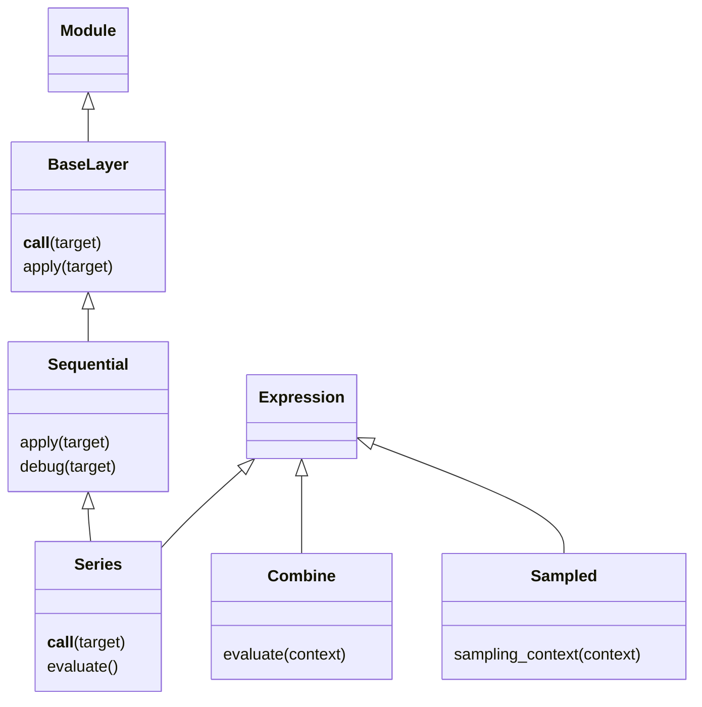

# Utilities

The utilities describe sampling and calculate arrays. They are available through
both `dLux` and `dLux.utils`; core fields and systems add physical modelling order.

## 1. Evaluate a definition on a grid

A Circle can supply the transmission array of an optical pupil.

```python
import dLux as dl

grid = dl.Grid(8, diam=1.2, unit="m")
aperture = dl.Circle(diameter=1.0)
print(aperture)
print(aperture.resolve(grid=grid).shape)
```

```text
Circle(diameter=f32[])
(8, 8)
```

Keeping `aperture` inside `Optic(transmission=aperture)` lets the optic supply
coordinates from the incident Wavefront when it is applied.

## 2. Compose operations

Sequential passes an input through named operations. `debug` also returns each
intermediate value, which is useful when constructing a new model.

```python
import jax.numpy as np
import zodiax as zdx

sequence = dl.Sequential({"scale": zdx.Map(s=2), "offset": zdx.Map(b=1)})
print(sequence)
print(sequence(np.array([1.0, 2.0])))
result, stages = sequence.debug(np.array([1.0, 2.0]))
```

```text
Sequential(layers={'scale': Map(s=i32[]), 'offset': Map(b=i32[])})
[3. 5.]
```

Series adds Expression behaviour to Sequential. It has no stored input: subclasses
such as JonesChain define their own starting value. `series(array)` applies steps
to an explicit array; resolving a plain Series without an input leaves it deferred.
Combine evaluates children independently, then sums or multiplies their arrays.



## 3. Find a numerical workflow

| Module guide | Typical task |
| --- | --- |
| [Grids](grids/overview.md) | Define coordinates and carry sampling with arrays |
| [Numerical](numerical/overview.md) | Interpolate, generate shapes and profiles, evaluate polynomials |
| [Bases](bases/overview.md) | Fit coefficients of fixed or generated modes |
| [Optical](optical/overview.md) | Compose Jones matrices and generate Zernike modes |
| [Photometry](photometry/overview.md) | Integrate spectra, filters and QE into photon counts |
| [Propagation](propagation/overview.md) | Propagate complex fields between sampled planes |

`astrometry.py` supplies Positions, Point, Binary and Companions; source usage is
shown in [systems](../systems/overview.md). `batching.py` supplies
ordinary array-batch helpers. Neither assigns a physical meaning to batch axes.

## Definitions and prepared operations

| Object | What it retains |
| --- | --- |
| `Circle(...)`, `Zernike(...)` | Parameters and optional sampling; updates affect the next evaluation |
| `Field(array, grid)` | Realised values and their sampling |
| `Interp(...).prepare()` | Interpax tables for the current source values and interpolation method |
| `Propagator(...).prepare(grid, wavelength)` | Numerical factors for one propagation setup |

Prepared operations are snapshots. Re-prepare after changing their defining inputs;
prepare inside the differentiated function when fitting those inputs. JIT compilation
is separate from preparation. A Module resolves its children while retaining its
structure; an Expression produces an array when its required context is available.
