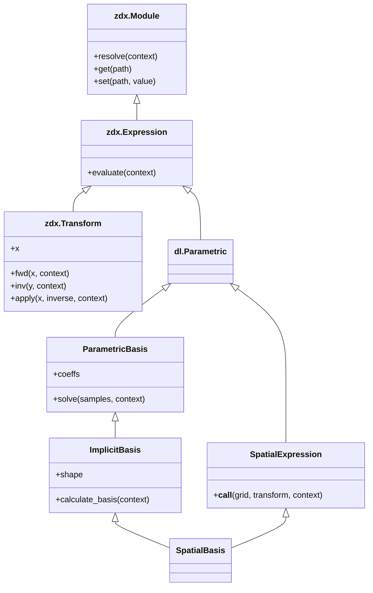
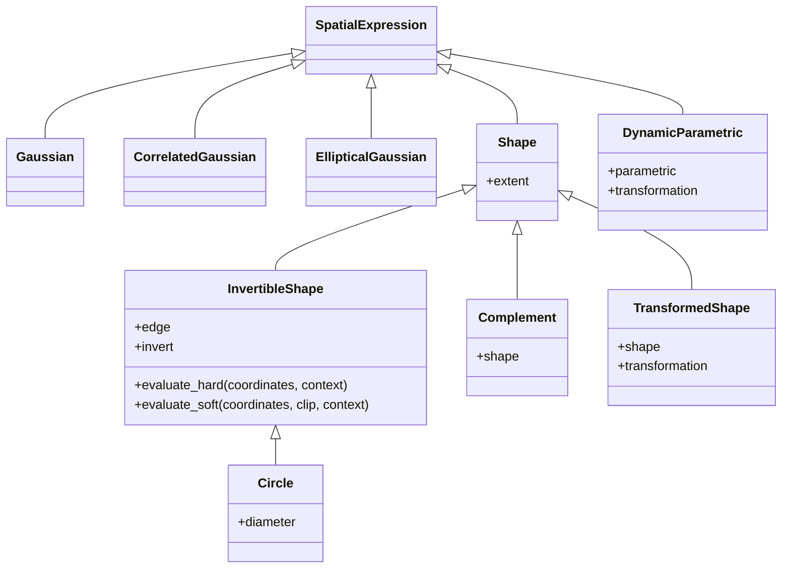
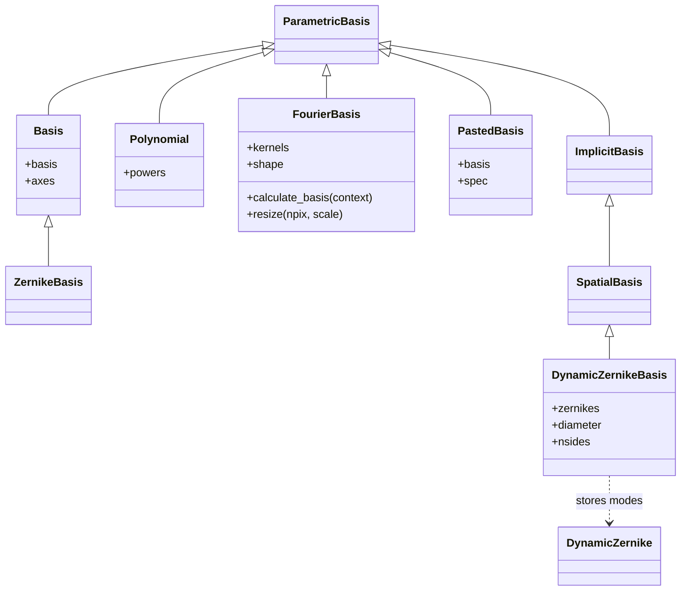

# Parametric API overview

A dLux parametric is a definition of a numerical value: an aperture transmission,
a mode expansion, an illumination profile, a spectrum, or a refractive index.
It stores physical parameters and calculates its value when the required named
inputs are available. The class retains the definition; evaluation produces arrays.

This overview describes the class contracts, ownership of calculations, and
relationships between families. Optical propagation and image formation belong to
layers and systems, which consume these values.

## 1. Evaluation and resolution

`dl.Parametric` inherits `zodiax.Expression`. Concrete calculations implement
`evaluate` directly, declaring their inputs in its signature. Zodiax supplies
resolution, parameter paths, immutable updates, and normal nested attribute raising.

| Operation | Input | Result | Owner |
|---|---|---|---|
| `evaluate(**context)` | Required named calculation inputs | Calculated value; missing or invalid inputs raise | Concrete definition, or a family implementation such as InvertibleShape |
| `resolve(**context)` | Available named inputs | Calculated value, or a partially prepared definition | Zodiax |
| `calculate_basis(**context)` | Inputs needed to generate modes | Unweighted basis arrays | Generated basis family |
| `solve(samples, **context)` | Sampled output and basis-generation inputs | Physical coefficient array | Basis family |

Every parametric evaluates. Basis families add mode generation or coefficient
solving where those operations are defined. A sampled Basis already stores its
modes in `basis`, so it does not need `calculate_basis`.

### Missing and invalid inputs

Context is a dictionary of named numerical inputs, such as `grid`, `coordinates`,
`wavelengths`, or external `state`. It is supplied for a calculation rather than
stored as a global evaluation environment.

- Required arguments on `evaluate` are checked by Zodiax during resolution.
- Requirements with alternatives are checked inside the calculation. Spatial
  definitions require grid or coordinates; if neither is supplied they raise
  `zdx.Unresolved`.
- `resolve` catches that signal and retains the definition, preparing available
  children. It does not catch ordinary shape, value, or calculation errors.
- Direct `evaluate` does not defer: a missing required signature argument raises
  TypeError; a missing alternative checked in the body raises Unresolved.
- Extra context is accepted by methods with `**context`. It is not automatically
  an alias for a required input: `wavels` does not satisfy `wavelengths`.
- Each calculation resolves its own stored operands with `zdx.resolve`. Children
  are not automatically resolved before the calculation starts.

```python
import jax.numpy as np
import dLux as dl

aperture = dl.Circle(diameter=0.8)
grid = dl.GridSpec(n=(32, 32), diam=1.0, unit="m")

print(aperture.resolve())
print(aperture.resolve(grid=grid).shape)
```

```text
Circle(edge=Hard(), invert=False, diameter=f32[])
(32, 32)
```

Resolution is immutable. Resolving an ordinary Module preserves its class and
prepares its fields; resolving a ready Expression replaces that expression with its
value. Retain the original definition when changing parameters or sampling.

## 2. Shared class contracts



| Contract | Responsibility | Subclass implementation |
|---|---|---|
| Parametric | A physical value defined by stored parameters | `evaluate` with explicit named inputs |
| SpatialExpression | Two-dimensional spatial evaluation and grid-call shorthand | `evaluate`; prepare inputs and perform the calculation directly |
| ParametricBasis | Stored physical coefficients and coefficient solving | `evaluate` and `solve` |
| ImplicitBasis | Store coefficients and mode-axis shape; share least-squares solving | `evaluate` and `calculate_basis` |
| SpatialBasis | Combine spatial calls with coefficient storage and grid-aware solving | `evaluate` and `calculate_basis` |

Spatial definitions implement `evaluate` with explicit named inputs. This method
prepares coordinates, resolves stored parameters and calculates the result.
Additional inputs required by a subclass belong in its `evaluate` signature.

Zodiax Transform defines numerical input mappings and can be stored as a parameter
inside a dLux parametric. Attribute raising exposes child methods: a raised method
acts on the child that owns it. Qualified paths make that ownership explicit.

## 3. Spatial definitions

The common evaluation signature is:

```text
evaluate(self, *, grid=None, coordinates=None, transform=None, **context)
```

| Input | Contract |
|---|---|
| `grid` | GridSpec supplying coordinates and pixel spacing in SI units, or native unitless units. A one-dimensional grid is promoted to a square two-dimensional sampling. |
| `coordinates` | Explicit Cartesian samples with shape `(..., 2, ny, nx)` in physical `(x, y)` order. Parameters use the same coordinate units. |
| `transform` | Optional BaseCoordTransform applied to evaluation coordinates. |
| `pixel_scale` in context | Scalar or per-axis spacing required by soft edges when coordinates are supplied directly. A grid supplies its own spacing. |

Grid and coordinates are mutually exclusive, including when they describe the
same sampling. Supplying both raises ValueError. Neither is inferred from a
Wavefront passed as unrelated context. Calling `definition(grid)` delegates to
resolution; named coordinate context also works through the inherited spatial call.

### Coordinate transformations and softening

A coordinate transformation changes where a definition is evaluated. It does not
resample stored images, transform sampled basis vectors, or change field-component
bases. A spatially constant value remains constant.

Soft edges use the physical half-width
`pixels * max(pixel_scale) / 2`. Coordinate transforms preserve that source scale,
including under scaling, shear and polynomial distortion. The width is a smoothing
convention, not pixel-area integration;
it need not occupy the same number of incoming samples after transformation.

Increasing sample count over the same physical extent reduces pixel spacing and
physical softening width. Averaging a finer aperture back to its original size gives
a higher-resolution approximation, with remaining differences near boundaries.

### Profiles and geometry



Circle represents the analytic shape family; Square, Rectangle, polygon shapes and
Spider use the same edge-selection contract. InvertibleShape implements evaluation
by selecting hard or soft geometry and optionally complementing the transmission.
A subclass with additional required evaluation inputs should expose them on its
own `evaluate` signature.

| Family | Stored parameters and result |
|---|---|
| Gaussian | Scalar or physical x/y standard deviations and centre; sampled peak-one profile |
| CorrelatedGaussian | x/y widths, correlation and centre; `cov` derives the covariance matrix |
| EllipticalGaussian | Major width, minor/major ratio, angle and centre; `minor` and `cov` derive physical quantities |
| Shape | Transmission array and a local geometric `extent` when defined |
| Hard / Soft | Ordinary Modules selecting binary evaluation or a pixel-width transition |
| Complement | `1 - shape.resolve(...)`, retaining the child's local extent |
| TransformedShape | Shape evaluated in a stored local coordinate frame, retaining its shape interface |
| DynamicParametric | Any child expression evaluated in a stored transformed frame |

Gaussian profiles are not sum-normalised. Scalar shape dimensions and Gaussian
parameters can have leading batches; these broadcast with coordinate batches.
Spider angles are one shared one-dimensional list. Hard boundaries do not provide
smooth geometry gradients; Soft provides a transition near the sampled boundary.

`extent` describes underlying local geometry. It is not a bound on transmission
after inversion, complementing or transformation. Derived properties such as
`extent`, `minor` and `cov` need numerical operands: resolve their owner with the
required context before accessing them when parameters are expressions.

## 4. Basis families

Let `C` denote mode axes, `B` coefficient batch axes and `O` sampled output axes.
An ordinary basis contraction maps modes `C + O` and coefficients `B + C` to
`B + O`. It adds no implicit normalisation; mode scaling defines coefficient units.



| Class | Representation | Evaluation / solving |
|---|---|---|
| Basis | Sampled tensor or expression in `basis`; `coeffs`; number of mode axes in `axes` | Contract resolved modes and coefficients; minimum-norm least-squares solve |
| ZernikeBasis | Modes sampled once at construction | Inherits Basis evaluation and solve |
| Polynomial | Integer powers and coefficients | Generate monomials for explicit variables or a spatial grid; paired leading coordinate/coefficient batches |
| FourierBasis | Compact separable kernels and coefficients | Evaluate without full modes; `calculate_basis` and `solve` materialise them |
| PastedBasis | Per-stamp modes, exact per-stamp coefficients, PasteSpec | Add overlapping stamps; solve by independent local stamp projection |
| DynamicZernikeBasis | Compact DynamicZernike modes and coefficients | Generate modes on current spatial sampling, contract, or solve |
| CLIMBBasis | Stored linear `expansion`, output endpoints and oversampling | Softly binarise and downsample the latent expansion; no coefficient solve on the nonlinear result |

Basis and generated Zernike/Fourier families retain independent leading coefficient
batches. Use explicit `vmap` when pairing independent generated grids and coefficient
batches. Polynomial instead broadcasts its leading coordinate and coefficient
batches together. PastedBasis requires its exact per-stamp coefficient shape;
it does not introduce arbitrary coefficient batches.

Polynomial variables need not describe a physical two-dimensional plane. A spatial
grid supplies two variables, while explicit coordinates support its general
D-variable contract. This is why Polynomial inherits ParametricBasis directly.

Dynamic Zernike pupil diameter is independent of grid extent. Evaluation context
can override the stored diameter; if both are None, the default is 2.0 in coordinate
units. No diameter or coordinates are inferred from a wavefront. `evaluate`,
`calculate_basis` and `solve` use this same convention. The current Zernike kernels
are intended for one coordinate grid at a time; use explicit mapping over grids.
Coordinate derivatives at the origin can be singular, unlike coefficient derivatives.

### Physical coefficients and nested transforms

```python
import zodiax as zdx

coefficients = zdx.Map(x=np.array([1.0, 2.0]), s=2.0)
basis = dl.Basis(np.eye(2), coeffs=coefficients)
values = basis.resolve()
physical = basis.solve(values)

print(values)
print(physical)
print(basis.coeffs.apply(physical, inverse=True))
```

```text
[2. 4.]
[2. 4.]
[1. 2.]
```

`solve` returns physical coefficients and does not reverse nested coefficient
transforms. Representative linear solves are minimum-norm least-squares solutions,
not necessarily unique inverses. PastedBasis's local projection is not a global
least-squares solve when stamps overlap. CLIMB's linear latent solve is available
through `climb.expansion.solve(...)`.

## 5. Composition, interpolation and wavelength models

These definitions share Parametric evaluation without requiring spatial inheritance.

| Class | Stored definition | Required evaluation inputs | Result |
|---|---|---|---|
| Combination | Named expressions and reduction | Inputs needed by its children | Broadcast-compatible sum, product, clipped-sum union or product intersection |
| Interpolation | `knots`, `values`, interpolation settings | `coordinates` in the knot unit | Query shape followed by trailing value axes |
| SpectralPolynomial | Nonconstant powers, coefficients and normalisation flag | `wavelengths` | Flat baseline plus polynomial perturbations on centred dimensionless samples |
| SpectralBasis | Sampled `expansion` and normalisation flag | Inputs needed by stored operands | Spectrum with trailing wavelength axis |
| Blackbody | Temperature and normalisation flag | Positive metre `wavelengths` | Relative photon-number spectrum; leading temperature batches |
| PolynomialIndex | `coeffs`, fixed powers and metre scale | Positive metre `wavelengths` | Dimensionless index polynomial in wavelength/scale |
| CauchyIndex | Same storage as PolynomialIndex | Positive metre `wavelengths` | Index polynomial in inverse-square normalised wavelength |
| InterpolatedIndex | Metre wavelength knots and scalar index values | Metre `wavelengths` | Interpolated dimensionless index |

InterpolatedIndex inherits Interpolation and changes the physical query and boundary
convention. Its constructor names are `wavelengths` and `indices`; the stored fields
remain `knots` and `values`. PolynomialIndex and CauchyIndex store `coeffs` directly.
Use these stored field names for parameter paths and updates, or declare custom
aliases.

Interpolation defaults to linear evaluation and zero fill outside its table.
InterpolatedIndex defaults to NaN outside its table.

Spectral normalisation is over the final sample axis. It weights samples equally;
it is not wavelength quadrature for nonuniform bins. Positive finite spectral
weights are a caller contract. Polynomial and basis spectra use unit-sum numerical
normalisation; Blackbody uses a stable logarithmic softmax. Refractive indices retain
arbitrary wavelength-query shapes; spectral generators take a scalar or a non-empty
one-dimensional sample vector.

## 6. Extension and ownership rules

1. Implement the calculation in `evaluate`, with its required scientific inputs
   visible. Handle alternatives explicitly with Unresolved for missing inputs and
   ordinary errors for invalid combinations.
2. Resolve only the stored operands the calculation uses, supplying their intended
   local context. A transform owner evaluates children in the transformed frame.
3. Keep static topology in constructors: mode selection, powers, dimensionality and
   sampling kernels. Numerical leaves remain differentiable where the kernel permits.
4. Keep shared array mathematics in `dLux.utils`. Parametrics own stored physical
   definitions, context and composition.
5. Preserve coordinate units, axis ordering, batching and normalisation contracts.
   Do not infer resampling or a physical inverse from a convenient numerical method.
6. Use inherited immutable updates and parameter paths. Numerical arrays and nested
   expressions have one storage location; aliases do not create duplicate leaves.

Optics and systems are consumers of these definitions. They supply the appropriate
sampling or wavelengths and use the resulting arrays. Parametrics themselves do
not apply optical layers, change wavefront grids or orchestrate propagation.

## 7. Package map

```text
dLux/parametric/
├── parametrics.py    Parametric, spatial contract, interpolation and composition
├── bases.py          coefficient contracts and sampled/compact expansions
├── gaussians.py      circular, correlated and elliptical profiles
├── polynomials.py    Polynomial and fixed/dynamic Zernike definitions
├── shapes.py         geometric transmission, edges and shape wrappers
├── spectral.py       spectral weights and normalisation ownership
├── refractive.py     wavelength-dependent refractive indices
└── overview.md       class relationships and API contracts
```

See the generated module references for complete constructor and method contracts:
[general parametrics](API/core/parametrics.md), [bases](API/core/bases.md),
[profiles](API/core/gaussians.md), [polynomials](API/core/polynomials.md),
[shapes](API/core/shapes.md), [spectra](API/core/spectral.md), and
[refractive indices](API/core/refractive.md).
